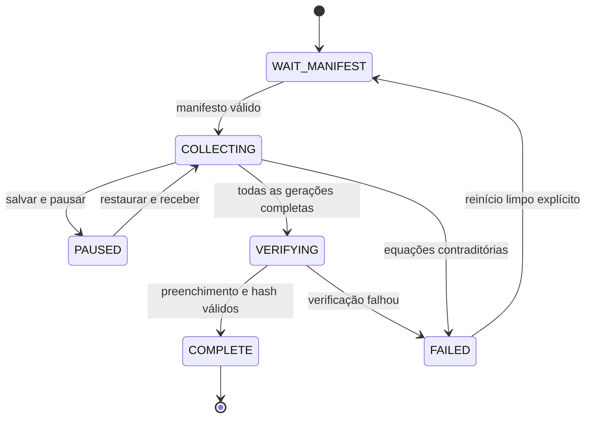

# OATP 0.1 — Especificação completa do protocolo

**Open Audio Transport Protocol**  
**Revisão documental:** 0.1.0-draft.1  
**Versão no fio:** major `0`, minor `1`  
**Data:** 17 de novembro de 2026  
**Estado:** proposta experimental; núcleo binário especificado e verificado em memória; sem validação acústica ou em rádio.

## Como usar este documento

Este arquivo reúne as decisões do projeto, o formato dos pacotes, o manifesto, o algoritmo de recuperação, as regras de emissão e recepção, a persistência, exemplos binários, uma referência executável e o plano de validação. Ele permite implementar o núcleo em linguagens e plataformas diferentes sem depender de uma biblioteca específica.

O nome mantém a origem do projeto em áudio, mas o núcleo recebe e produz **pacotes de bytes**. Um adaptador externo transforma esses pacotes em áudio, datagramas, imagens ou outro meio. Nenhuma modulação está congelada nesta versão.

As seções 1–15 definem o comportamento do núcleo. A seção 16 registra o que foi efetivamente verificado. As seções 17–21 apresentam integração, antecedentes e evolução. O Apêndice A contém código ilustrativo; o Apêndice B contém vetores de conformidade e o Apêndice C, um exemplo de execução. As regras e os vetores são a referência para interoperabilidade; o código é uma implementação didática dessas regras.

### Índice

- [1. Objetivos e escopo](#1-objetivos-e-escopo)
- [2. Termos e convenções](#2-termos-e-convenções)
- [3. Separação de responsabilidades](#3-separação-de-responsabilidades)
- [4. Modelo do objeto e limites](#4-modelo-do-objeto-e-limites)
- [5. Formato binário do pacote](#5-formato-binário-do-pacote)
- [6. Manifesto](#6-manifesto)
- [7. Fragmentação canônica](#7-fragmentação-canônica)
- [8. Algoritmo de recuperação `RLNC-S64-G64`](#8-algoritmo-de-recuperação-rlnc-s64-g64)
- [9. Emissão, redundância e recepção tardia](#9-emissão-redundância-e-recepção-tardia)
- [10. Recepção e estados](#10-recepção-e-estados)
- [11. Persistência, retomada e retransmissão](#11-persistência-retomada-e-retransmissão)
- [12. Limites de recursos, integridade e erros](#12-limites-de-recursos-integridade-e-erros)
- [13. Eficiência e exemplo completo de 1.000 bytes](#13-eficiência-e-exemplo-completo-de-1000-bytes)
- [14. Compatibilidade e evolução](#14-compatibilidade-e-evolução)
- [15. Critérios de conformidade](#15-critérios-de-conformidade)
- [16. Verificação realizada nesta revisão](#16-verificação-realizada-nesta-revisão)
- [17. Integração com infraestrutura e aplicações](#17-integração-com-infraestrutura-e-aplicações)
- [18. Tecnologias relacionadas e posição desta proposta](#18-tecnologias-relacionadas-e-posição-desta-proposta)
- [19. Plano de validação e critérios de avaliação](#19-plano-de-validação-e-critérios-de-avaliação)
- [20. Evolução e decisões futuras](#20-evolução-e-decisões-futuras)
- [21. Referências](#21-referências)
- [Apêndice A — Referência executável do núcleo](#apêndice-a--referência-executável-do-núcleo)
- [Apêndice B — Vetores de conformidade](#apêndice-b--vetores-de-conformidade)
- [Apêndice C — Exemplos reproduzíveis](#apêndice-c--exemplos-reproduzíveis)

### Decisões consolidadas

| Item | Decisão desta revisão |
|---|---|
| Unidade transportada | Objeto binário imutável, sem interpretação do conteúdo |
| Criptografia, compressão e assinaturas | Responsabilidade da aplicação, antes e depois do OATP |
| Canal de retorno | Não obrigatório; sem ACK ou negociação no núcleo |
| Símbolo original | 64 bytes |
| Geração | Até 64 símbolos; até 4.096 bytes originais |
| Recuperação | Código linear sistemático sobre GF(256), perfil próprio `RLNC-S64-G64` |
| Orçamento inicial | K símbolos originais + teto de K/2 reparações, por geração |
| Continuidade | Novas reparações de todas as gerações enquanto a aplicação mantiver a emissão |
| Pacote | 100 bytes: cabeçalho de 32, carga de 64, CRC-32C de 4 |
| Manifesto | 64 bytes; repetido no início e entre pacotes de símbolos |
| Integridade | CRC-32C de cada pacote; SHA-256 do objeto completo |
| Identificação | Hash do manifesto; 16 bytes no cabeçalho, 32 bytes no algoritmo |
| Limite do objeto | 64 MiB; implementações podem declarar cotas locais menores |
| Recepção | Fora de ordem, entrada tardia e retomada com estado persistido |
| Entrega | Somente após reconstrução completa, preenchimento válido e hash correspondente |
| Prioridade, descoberta e roteamento | Não definidos no núcleo 0.1 |

### Correções em relação à conversa exploratória

O cabeçalho de 24 bytes e o total de 88 bytes eram provisórios e não incluíam um formato completo para os campos e a proteção do pacote. Esta revisão os substitui pelo formato de **100 bytes**, com todos os offsets definidos.

“Fountain Codes” designava uma família de técnicas, não um algoritmo interoperável. Aqui escolhemos um perfil exato de codificação linear por gerações, com coeficientes reproduzíveis. Ele não é LT, RaptorQ, MUR nem uma implementação do RFC 8681.

“50% de redundância” passa a significar o orçamento inicial de **pacotes de símbolos**, sem incluir manifestos, cabeçalhos ou o modem. “Integridade absoluta” é substituída por verificações explícitas com suas limitações: CRC e hash não autenticam o emissor.

OATP não reivindica novidade matemática nem eficiência superior. Há antecedentes próximos em MUR, AMP/FLAMP e FLUTE, além de esquemas FEC padronizados. A seção 18 compara seus papéis e corrige a impressão de que a transmissão binária genérica seria inédita.

## 1. Objetivos e escopo

O OATP transporta uma sequência finita de bytes através de um meio que pode perder, duplicar, reordenar ou corromper pacotes. O receptor coleta informações válidas até conseguir reconstruir o objeto integralmente.

O projeto deve permitir que o receptor comece depois do início da transmissão, interrompa a recepção, preserve o progresso e continue em outro momento. Para isso, o transmissor precisa permanecer disponível ou voltar a anunciar a mesma transferência, e o receptor precisa obter informação suficiente de **cada geração**.

O núcleo DEVE tratar o conteúdo como bytes opacos. Um texto, arquivo, transação Bitcoin assinada ou conteúdo já cifrado segue exatamente as mesmas regras. Não há campo de carteira, destinatário, cifra, chave, tipo de arquivo, urgência ou taxa financeira.

O núcleo NÃO DEVE alterar o conteúdo por conversão de caracteres, normalização, compactação, criptografia ou interpretação automática. O preenchimento de zeros definido adiante pertence apenas à representação para codificação e é retirado antes da entrega.

O núcleo não garante alcance, qualidade de áudio, disponibilidade do canal, horário de conclusão ou que qualquer rádio compreenda qualquer modem. A infraestrutura deve entregar candidatos a pacotes de 100 bytes. Um candidato pode ser rejeitado, e uma quantidade insuficiente de informação pode deixar a transferência incompleta indefinidamente.

O tipo de FEC adotado recupera **apagamentos**, isto é, pacotes ausentes ou descartados. Corrupção detectada pelo CRC é convertida em descarte. O decodificador não foi projetado para identificar e corrigir equações falsas que passaram nas verificações. Essa separação segue a distinção usada nos esquemas de FEC para pacotes [R6].

## 2. Termos e convenções

| Termo | Significado |
|---|---|
| Objeto | Os bytes originais entregues pela aplicação |
| Transferência | Um objeto, seus parâmetros canônicos e um `instance_tag` imutável |
| Símbolo original | Bloco de 64 bytes do objeto, com zero no preenchimento final |
| Geração | Grupo de até 64 símbolos originais codificado independentemente |
| Símbolo sistemático | Um símbolo original enviado sem combinação com outros |
| Símbolo de reparação | Combinação linear de símbolos da mesma geração |
| Pacote/quadro | Cabeçalho, carga e CRC; exatamente 100 bytes |
| ESI | Encoding Symbol ID; índice que determina o símbolo codificado |
| Manifesto | Metadados necessários para interpretar e conferir uma transferência |
| Posto ou rank | Número de equações linearmente independentes acumuladas |
| Pacote inovador | Pacote que aumenta o posto da geração |
| Adaptador | Componente que transporta os quadros pelo meio escolhido |

**DEVE** indica requisito; **NÃO DEVE**, proibição; **RECOMENDA-SE**, comportamento padrão com exceções justificáveis; **PODE**, opção. Essas palavras se aplicam a este rascunho, sem atribuir a ele status de padrão de uma organização externa.

Um byte possui oito bits. Inteiros são **sem sinal e big-endian**. Índices começam em zero. `u16be`, `u32be` e `u64be` representam exatamente 2, 4 e 8 bytes. `A || B` é concatenação; `XOR` é soma bit a bit. Intervalos de bytes como `[0:16]` incluem o início e excluem o fim. Hashes em hexadecimal servem à apresentação; no fio são bytes binários.

Nenhum comprimento, índice, hash ou coeficiente depende de locale, relógio, arquitetura da CPU, gerador aleatório nativo ou representação de ponto flutuante. A aritmética de codificação usa somente inteiros e operações no corpo finito.

## 3. Separação de responsabilidades

| Camada | Recebe | Produz | Responsabilidade |
|---|---|---|---|
| Aplicação emissora | Dados de negócio | Objeto binário imutável | Escolher o conteúdo e qualquer tratamento anterior |
| OATP emissor | Objeto | Quadros de 100 bytes | Manifesto, símbolos, reparações e programação de envio |
| Adaptador | Quadros | Sinais ou unidades do meio | Enquadramento externo, modulação, temporização e acesso ao canal |
| Adaptador receptor | Sinais ou unidades do meio | Candidatos a quadros | Demodular e recuperar os limites dos quadros |
| OATP receptor | Candidatos a quadros | Objeto verificado ou estado incompleto/falho | Validar, acumular, reconstruir e conferir |
| Aplicação receptora | Objeto verificado | Ação de negócio | Interpretar e autorizar qualquer uso do conteúdo |

Correção de erros dentro do modem pode coexistir com o código de apagamentos do OATP. São proteções em níveis diferentes. O CRC do OATP permanece obrigatório, mesmo que a camada inferior também tenha um checksum.

Não há handshake de parâmetros. A versão e o perfil têm valores fixos e são anunciados no quadro e no manifesto. Um receptor sem suporte rejeita a transferência de modo local; não precisa transmitir uma resposta.

## 4. Modelo do objeto e limites

Defina:

```text
L = comprimento original, em bytes
B = 64                          tamanho de símbolo
C = 64                          capacidade de uma geração
S = (L + 63) // 64               símbolos originais totais
G = (S + 63) // 64               gerações totais
K(g) = min(64, S - 64*g)         símbolos da geração g
```

As fórmulas usam divisão inteira. `K(g)` só é definido para `0 <= g < G`. Se `L = 0`, então `S = G = 0` e nenhum pacote de símbolo existe.

| Limite | Valor |
|---|---:|
| Comprimento original permitido | 0 a 67.108.864 bytes, inclusive |
| Máximo de símbolos originais | 1.048.576 |
| Máximo de gerações | 16.384 |
| Maior índice de geração válido | 16.383 |
| Símbolos por geração não vazia | 1 a 64 |
| ESI | 0 a 4.294.967.295, inclusive |
| Pacote individual | Exatamente 100 bytes |

O campo de comprimento possui 64 bits, mas isso NÃO amplia o limite do perfil. Um manifesto maior que 64 MiB DEVE ser rejeitado antes de qualquer alocação proporcional. Todas as operações de tamanho e deslocamento DEVEM detectar overflow em linguagens de inteiros limitados.

Um produto pode impor cotas menores, desde que as exponha à aplicação e sinalize a rejeição. Conformidade de formato não exige memória ilimitada nem aceitação automática de toda mensagem recebida.

O objeto DEVE ser congelado antes do cálculo do manifesto. Alterar um byte durante a emissão exige uma nova transferência. Para arquivos grandes, uma implementação pode trabalhar sobre um snapshot estável em disco em vez de copiar tudo para RAM.

## 5. Formato binário do pacote

### 5.1 Estrutura fixa

```text
pacote = cabecalho[32] || carga[64] || u32be(CRC32C(cabecalho || carga))
comprimento = 100 bytes
```

Não há campo de comprimento, CRC separado de cabeçalho, extensão opcional ou alinhamento implícito. Os primeiros 96 bytes são a entrada do CRC; os últimos quatro contêm o valor calculado.

### 5.2 Cabeçalho de 32 bytes

| Offset | Campo | Bytes | Tipo/valor |
|---:|---|---:|---|
| 0 | `magic` | 4 | ASCII `OATP`, hexadecimal `4f 41 54 50` |
| 4 | `version_major` | 1 | `0x00` |
| 5 | `version_minor` | 1 | `0x01` |
| 6 | `packet_type` | 1 | `0x01` MANIFEST ou `0x02` SYMBOL |
| 7 | `flags` | 1 | `0x00`; nenhum bit definido |
| 8 | `transfer_id` | 16 | Primeiros 16 bytes do hash canônico do manifesto |
| 24 | `generation_id` | 4 | `u32be` |
| 28 | `esi` | 4 | `u32be` |
| 32 | `payload` | 64 | Manifesto ou símbolo codificado |
| 96 | `crc32c` | 4 | Valor numérico do CRC, serializado em big-endian |

No tipo MANIFEST, `generation_id` DEVE ser `0xffffffff` e `esi` DEVE ser zero. Repetir o manifesto não incrementa o ESI: o quadro inteiro permanece idêntico.

No tipo SYMBOL, `generation_id` DEVE estar no intervalo do manifesto. `0xffffffff` nunca representa uma geração de dados. O significado do ESI é relativo ao `K(g)` real, inclusive na última geração menor.

Versão diferente, tipo desconhecido ou flags não zero DEVEM causar rejeição; não são instruções para adivinhar um formato alternativo. Bytes extras não são ignorados.

### 5.3 CRC-32C

| Parâmetro | Valor |
|---|---|
| Largura | 32 bits |
| Polinômio normal | `0x1EDC6F41` |
| Polinômio refletido usado no algoritmo bit a bit | `0x82F63B78` |
| Inicialização | `0xFFFFFFFF` |
| Entrada e saída refletidas | Sim |
| XOR final | `0xFFFFFFFF` |
| Vetor de controle | `CRC32C(ASCII("123456789")) = 0xE3069283` |
| Bytes desse valor no OATP | `e3 06 92 83` |

Esses parâmetros identificam CRC-32C/Castagnoli [R2]. A escolha de **big-endian no trailer** é do OATP; reflexão dos bits e ordem de bytes são conceitos diferentes. No algoritmo refletido do Apêndice A, não se aplica uma segunda reflexão manual ao resultado.

O receptor compara o inteiro recebido com o CRC dos primeiros 96 bytes. O campo CRC NÃO é zerado e incluído na conta: ele fica inteiramente fora da entrada. CRC inválido elimina o pacote antes de alimentar a matriz de recuperação.

## 6. Manifesto

### 6.1 Conteúdo de 64 bytes

Os offsets desta tabela são relativos à carga do pacote, cujo primeiro byte ocupa o offset 32 do quadro completo.

| Offset | Campo | Bytes | Regra |
|---:|---|---:|---|
| 0 | `manifest_schema` | 1 | `0x01` |
| 1 | `fec_profile` | 1 | `0x01`, perfil `RLNC-S64-G64` |
| 2 | `symbol_size` | 2 | `u16be(64)`, bytes `00 40` |
| 4 | `generation_capacity` | 2 | `u16be(64)` |
| 6 | `reserved` | 2 | Dois bytes zero |
| 8 | `object_length` | 8 | `u64be(L)` |
| 16 | `object_sha256` | 32 | SHA-256 dos L bytes exatos da aplicação |
| 48 | `instance_tag` | 16 | Identificador opaco da instância; zero por padrão |

O SHA-256 segue FIPS 180-4 [R1]. Ele é calculado **antes do preenchimento**. Quando a aplicação fornecer dados cifrados, o hash abrangerá os dados cifrados recebidos pelo OATP, sem tentar acessar o conteúdo anterior.

O manifesto não repete `S`, `G` ou `K`: esses valores são derivados de `L`. Assim não existem cópias contraditórias de contagens que precisariam de arbitragem.

### 6.2 Identidade e ausência de dependência circular

```text
ID_DOMAIN = ASCII("OATP-ID-v1") || 0x00
manifest_key = SHA256(ID_DOMAIN || manifesto_de_64_bytes)
transfer_id = manifest_key[0:16]
```

`ID_DOMAIN` possui 11 bytes, exatamente:

```text
4f 41 54 50 2d 49 44 2d 76 31 00
```

O manifesto não contém o `transfer_id`; portanto não há hash de um campo que depende de si mesmo. Primeiro calcula-se o hash do conteúdo, depois serializa-se o manifesto, depois calcula-se a identidade.

Apesar do nome `manifest_key`, esse valor **não é uma chave secreta**. É um digest público de 32 bytes. Os 32 bytes completos são usados na geração dos coeficientes; a forma truncada de 16 bytes economiza espaço no cabeçalho.

Para aceitar um manifesto, o receptor DEVE validar seus parâmetros, recalcular `manifest_key` e verificar se seu prefixo corresponde ao `transfer_id` do cabeçalho. O CRC sozinho não valida essa associação.

### 6.3 `instance_tag`

O padrão é uma sequência de 16 zeros. Nesse caso, mesmos bytes e mesmos parâmetros geram o mesmo manifesto, identidade e conjunto de símbolos. Isso permite juntar recepções de diferentes sessões ou retransmissores que preservem esses valores.

A aplicação PODE fornecer outros 16 bytes para distinguir uma nova transferência dos mesmos dados. O valor é escolhido uma vez, antes da criação do manifesto, e permanece imutável. Não há requisito de relógio ou de método de geração desse identificador.

`instance_tag` não é prioridade, autenticação, chave nem nonce de uma cifra. Trocar o tag cria outra identidade: os fragmentos antigos não devem ser misturados com os novos. Se a intenção for retomar uma transferência existente, deve-se reutilizar o manifesto inteiro.

### 6.4 Vazio, repetição e colisão

Um objeto vazio é válido se `object_length = 0` e o digest for SHA-256 de zero bytes:

```text
e3b0c44298fc1c149afbf4c8996fb92427ae41e4649b934ca495991b7852b855
```

Um manifesto válido basta para reconstruí-lo; não se inventa uma geração vazia. A aplicação emissora precisa continuar repetindo o manifesto se desejar atender receptores que cheguem depois.

Manifestos idênticos são repetições idempotentes. Se dois manifestos diferentes, cada um válido por si, tiverem o mesmo `transfer_id`, o receptor DEVE registrar conflito de identidade e impedir a mistura. Ele NÃO DEVE escolher silenciosamente o último manifesto. O hash completo é conservado no estado local para comparar as identidades sem depender apenas do prefixo.

## 7. Fragmentação canônica

### 7.1 Formação dos símbolos originais

Para `0 <= i < S`:

```text
X[i] = objeto[64*i : min(64*(i+1), L)]
completar X[i] à direita com 0x00 até obter 64 bytes
```

O último símbolo é o único que pode precisar de preenchimento. Não se acrescenta um símbolo adicional quando `L` já é múltiplo de 64.

A geração `g` contém `X[64*g]` até `X[64*g + K(g) - 1]`, nessa ordem. Dentro da geração esses símbolos são renumerados `x[0]` até `x[K-1]`.

### 7.2 Exemplos de fronteira

| L, bytes | Símbolos S | Gerações G | K por geração | Preenchimento total |
|---:|---:|---:|---|---:|
| 0 | 0 | 0 | Nenhuma | 0 |
| 1 | 1 | 1 | 1 | 63 |
| 64 | 1 | 1 | 1 | 0 |
| 65 | 2 | 1 | 2 | 63 |
| 1.000 | 16 | 1 | 16 | 24 |
| 4.096 | 64 | 1 | 64 | 0 |
| 4.097 | 65 | 2 | 64, 1 | 63 |
| 8.193 | 129 | 3 | 64, 64, 1 | 63 |

Nenhuma reparação mistura gerações. Isso limita o custo algébrico, mas exige receber informação suficiente em todas elas. Um excesso de pacotes da geração zero não compensa uma geração um totalmente ausente.

## 8. Algoritmo de recuperação `RLNC-S64-G64`

### 8.1 Escolha do perfil

O perfil `0x01` é um código linear sistemático por gerações, com coeficientes pseudorrandômicos determinísticos sobre GF(256). Ele foi escolhido por ser possível descrevê-lo integralmente com regras pequenas e verificáveis. A arquitetura de combinações lineares e recuperação por posto tem precedentes na família RLC [R4]; as regras de fio e o gerador de coeficientes aqui são próprios.

O uso é semelhante a um fountain code: não é necessário fixar antecipadamente quantas reparações serão emitidas. Entretanto, o espaço de ESI é finito e novos ESIs podem gerar equações dependentes. Não se promete uma fonte infinita de informação nova.

Esta escolha não transfere ao OATP as propriedades de Reed–Solomon ou RaptorQ. Particularmente, **quaisquer K pacotes diferentes não são garantia de recuperação**.

### 8.2 Aritmética GF(256)

Cada byte representa um elemento do corpo. O bit de posição `j` é o coeficiente de `x^j`. Soma e subtração são XOR. Multiplicação é o produto dos polinômios reduzido módulo:

```text
p(x) = x^8 + x^4 + x^3 + x^2 + 1
p = 0x11D
```

Esse polinômio também aparece na especificação de GF(256) do RFC 5510 [R3]. Ele não é o polinômio `0x11B` usado em outras construções; uma troca entre ambos quebra a interoperabilidade.

Para elemento não nulo `a`, o inverso é `a^254` com multiplicações no mesmo corpo. Zero não possui inverso. Multiplicações comuns de inteiros módulo 256 NÃO substituem a multiplicação GF(256).

### 8.3 Vetor de coeficientes

Para cada par `(g, esi)`, derive `K = K(g)` do manifesto.

**Caso sistemático, `0 <= esi < K`:** o vetor `a` tem K bytes, todos zero, exceto `a[esi] = 1`.

**Caso de reparação, `K <= esi <= 0xffffffff`:** use:

```text
COEF_DOMAIN = ASCII("OATP-COEF-v1") || 0x00
prefixo = COEF_DOMAIN || manifest_key || u32be(g) || u32be(esi) || u16be(K)
D[t] = SHA256(prefixo || u32be(t))
expandido = D[0] || D[1] || ...
a = os primeiros K bytes de expandido
se todos os bytes de a forem zero: a[0] = 1
```

`t` começa em zero. O domínio tem 13 bytes:

```text
4f 41 54 50 2d 43 4f 45 46 2d 76 31 00
```

Como K é no máximo 64, bastam um ou dois hashes. Para K até 32 usa-se somente `D[0]`; acima de 32 concatenam-se `D[0]` e `D[1]`. Não há rejeição de coeficientes individuais zero, embaralhamento, distribuição de graus, biblioteca de PRNG ou conversão para floats.

A substituição do vetor inteiramente zero evita transmitir uma equação sem conteúdo. Para K igual a um, todo coeficiente de reparação resultante é não nulo, de modo que um símbolo de reparação correto basta para recuperar essa geração.

### 8.4 Cálculo do símbolo codificado

Cada símbolo de carga possui 64 bytes. Para cada posição `j` entre zero e 63:

```text
y[j] = XOR, para i de 0 até K-1, de gf_mul(a[i], x[i][j])
```

O resultado `y` é a carga de um pacote SYMBOL. O vetor de coeficientes não é enviado; o receptor o reproduz com o manifesto, `generation_id` e `esi`.

Um mesmo `(manifesto, g, esi)` DEVE produzir os mesmos 64 bytes em toda implementação. Retransmissões NÃO DEVEM reaproveitar o mesmo ESI para um conteúdo diferente. Zero nos coeficientes não elimina a posição do vetor: a correspondência com os símbolos permanece fixa.

### 8.5 Reconstrução incremental

Cada pacote aceito representa a equação vetorial `a * X = y`. Para cada geração, o receptor mantém uma base escalonada de no máximo K equações independentes.

Um algoritmo de referência é Gauss–Jordan incremental:

1. Reproduzir `a` e copiar a carga para `y`.
2. Para cada pivô já armazenado, em ordem crescente, eliminar da nova linha o coeficiente naquela coluna.
3. Se `a` se tornar zero e `y` também for zero, descartar a equação como dependente. O progresso não aumenta.
4. Se `a` se tornar zero mas `y` não, registrar contradição e falhar a transferência; não tentar entregar dados dessa base.
5. Caso contrário, escolher a primeira coluna não nula como pivô, multiplicar a linha e a carga pelo inverso do coeficiente e tornar o pivô igual a um.
6. Eliminar esse novo pivô das linhas anteriores e inserir a nova linha.
7. Quando houver K pivôs, ordenar as linhas pelas colunas dos pivôs. As cargas são os K símbolos originais, ainda provisórios até a conferência do objeto.

Uma implementação PODE usar eliminação em lote ou outro método matematicamente equivalente. O que determina o sucesso é o posto K, não uma ordem de chegada particular nem a quantidade de ESIs distintos.

As operações devem afetar simultaneamente os coeficientes e os 64 bytes do lado direito. A mesma matriz serve a todas as posições de byte; não é necessário executar 64 seleções de pivô diferentes.

### 8.6 Conclusão e verificação

Depois de recuperar todas as gerações:

1. Concatenar gerações por `g`, e símbolos por seu índice original.
2. Verificar que todos os bytes após a posição L são zero. Preenchimento não zero é uma falha.
3. Recortar exatamente L bytes.
4. Calcular SHA-256 dos bytes recortados e comparar com `object_sha256`.
5. Somente se a comparação for igual, marcar a transferência como verificada e disponibilizar o objeto à aplicação.

Nenhuma geração individual possui um hash próprio nesta versão. Se o hash final falhar, o receptor não consegue determinar por essa verificação qual geração está errada. A política padrão é falhar a transferência e exigir uma tentativa limpa, descartando a base anterior. Adicionar mais equações à mesma base contaminada não é uma recuperação garantida.

## 9. Emissão, redundância e recepção tardia

### 9.1 Orçamento inicial

Para cada geração com K símbolos:

```text
R = (K + 1) // 2        reparações iniciais, isto é, ceil(K/2)
N = K + R              pacotes de símbolos iniciais
ESI inicial: 0 até N-1
```

Os ESIs de zero até K−1 são sistemáticos; os R seguintes são reparações. Para K ímpar, o arredondamento gera um pouco mais de 50% de reparações em relação aos originais.

O transmissor padrão percorre ESIs crescentes. Para cada ESI, percorre as gerações em ordem crescente e emite para aquelas em que o ESI ainda é menor que seu N. Assim evita terminar uma geração grande inteira antes de apresentar qualquer dado da próxima.

### 9.2 Cadência do manifesto

O agendamento inicial canônico DEVE:

1. Emitir um manifesto antes do primeiro símbolo.
2. Emitir outro manifesto depois de cada oito pacotes SYMBOL dessa transferência.
3. Ao encerrar a fase inicial com um grupo parcial de um a sete símbolos, emitir um manifesto de fechamento.
4. Se o último símbolo já tiver provocado o manifesto periódico, não acrescentar outro apenas para fechar a fase.

Uma pausa ou retomada PODE antecipar um manifesto adicional. O contador de símbolos desde o último manifesto é zerado sempre que um manifesto é emitido. Outros objetos no canal não entram nesse contador.

Na fase inicial de um objeto não vazio, se `T = soma de N(g)`:

```text
manifestos = 1 + ceil(T / 8)
quadros totais = T + 1 + ceil(T / 8)
```

Para um objeto vazio, a fase inicial é um único manifesto. Repetições posteriores são controladas pela aplicação.

Essa cadência limita a distância entre anúncios em **pacotes enviados**, não o tempo até receber um manifesto. Se todos os manifestos forem perdidos, o receptor pode continuar sem os parâmetros, mesmo recebendo símbolos.

### 9.3 Modo contínuo

Depois da fase inicial, o próximo ESI de cada geração é `N(g)`. Em cada rodada, o emissor produz uma nova reparação de cada geração, em ordem crescente, e incrementa o ESI daquela geração. Deve continuar visitando todas as gerações; somente continuar a última não atende receptores tardios.

Na abertura ou retomada de uma fase contínua, envia-se um manifesto, mesmo que isso repita o último quadro anterior. Mantém-se a inserção de um manifesto após no máximo oito símbolos. O emissor decide localmente por quanto tempo continuar; não há sinal de fim obrigatório para o receptor.

Os contadores de ESI e a próxima geração DEVEM ser preservados quando se deseja continuar produzindo novas reparações após uma reinicialização. Reenviar quadros antigos é permitido, mas não deve ser contabilizado como informação nova garantida.

Não há wrap de ESI. Depois de usar `0xffffffff` para uma geração, o emissor deve encerrar a emissão de novos símbolos dessa transferência. Ele pode repetir quadros existentes ou iniciar explicitamente outra transferência com outro tag. Nesse segundo caso, o progresso anterior não se combina automaticamente.

### 9.4 O que os 50% permitem concluir

Para K igual a 16, a emissão inicial tem 24 pacotes de símbolos. Perder oito deixa 16 candidatos a equações: ainda é necessário que sejam independentes. Perder 12 deixa apenas 12, insuficientes para reconstruir 16 símbolos arbitrários.

Em geral, a condição meramente quantitativa é `perdas <= R`. Para K par, R corresponde a **um terço do total enviado**, não metade. Independência, perdas de manifesto e distribuição de perdas entre gerações continuam relevantes.

Um receptor que chega depois do início não precisa de símbolos sistemáticos. Ele pode recuperar cada geração usando apenas reparações, desde que reúna posto suficiente e tenha o manifesto. Se o transmissor parar cedo demais, não existe garantia de conclusão.

### 9.5 Modelo matemático informativo

Para m vetores de K coeficientes **uniformes e independentes** sobre GF(256), com `m >= K`, a probabilidade de posto completo é:

```text
P(posto K) = produto, para i=0..K-1, de (1 - 256^(i-m))
se m = K+s: P(falha de posto) < 256^(-s) / 255
```

Esse é um modelo de matrizes aleatórias, não uma medição do OATP. A fórmula decorre de contar as escolhas que não pertencem aos subespaços já ocupados. O tratamento do vetor zero adotado aqui não piora esse limite no modelo ideal; ele substitui uma equação inútil por uma equação não nula.

| Reparações recebidas além de K | Limite superior no modelo ideal |
|---:|---:|
| 0 | 0,392157% de falha de posto |
| 1 | 0,00153187% |
| 2 | 0,00000598384% |

Os coeficientes reais são determinísticos. Não se atribuem esses percentuais a qualquer sequência concreta de ESIs, a perdas adversariais ou a um rádio. Repetições não são amostras independentes; várias gerações precisam todas concluir. Testes e medições devem tratar isso separadamente.

## 10. Recepção e estados

### 10.1 Validação antes da álgebra

O receptor DEVE validar o comprimento de 100 bytes, o magic, a versão, o tipo, os campos reservados e o CRC antes de usar qualquer pacote na recuperação. Verificações baratas podem preceder o CRC, mas nenhuma alteração da base é permitida antes da validação completa do quadro.

Para MANIFEST, também valida os parâmetros e limites, o hash vazio quando aplicável e a correspondência do identificador. Para SYMBOL, precisa de um manifesto aceito e verifica o intervalo da geração antes de alocar sua base.

Um ESI cabe em u32 e não determina quantos símbolos originais existem; K sempre vem do comprimento no manifesto. O receptor NÃO DEVE alocar uma lista com tamanho proporcional ao ESI recebido.

### 10.2 Estados por transferência

| Estado | Significado | Próxima transição normal |
|---|---|---|
| `WAIT_MANIFEST` | Há candidatos a símbolos, mas faltam os parâmetros | Manifesto válido → `COLLECTING` |
| `COLLECTING` | Acumulando bases; alguns grupos podem estar resolvidos | Todos completos → `VERIFYING` |
| `PAUSED` | Estado salvo; canal ausente ou aplicação pausada | Retomada → `COLLECTING` |
| `VERIFYING` | Conferindo preenchimento e hash do objeto | Igual → `COMPLETE`; divergente → `FAILED` |
| `COMPLETE` | Objeto inteiro verificado | Permanecer concluído e tratar repetições |
| `FAILED` | Conflito ou integridade final incorreta | Somente reinício limpo explícito |
| `REJECTED` | Versão, perfil, parâmetros ou limites não aceitos | Nenhuma alocação de recuperação |



O vazio segue diretamente de um manifesto válido para verificação e conclusão. Um pacote perdido ou com CRC incorreto é descartado; ele não exige falhar toda a transferência. Ausência de novos dados pode causar pausa local, mas não deve ser apresentada como conclusão.

`REJECTED` descreve a admissão de uma transferência candidata. Um quadro inválido ou não suportado NÃO DEVE mudar uma transferência ativa já aceita para `REJECTED` ou `FAILED` apenas por trazer seu identificador. A falha de uma transferência existente exige uma condição própria, como conflito de manifestos individualmente válidos, contradição entre equações aceitas ou falha da verificação final.

### 10.3 Recepção antes do manifesto

O receptor PODE guardar quadros SYMBOL com CRC válido em uma fila de órfãos, indexada pelo `transfer_id`. Eles ainda não foram validados em relação a K e G e NÃO DEVEM alimentar uma matriz.

Política local inicial recomendada: no máximo oito identidades desconhecidas, até 128 quadros por identidade, no máximo 102.400 bytes brutos de quadros nessa fila, sem contar metadados. Ao exceder a cota, descartar primeiro a entrada desconhecida menos recentemente utilizada. A aplicação pode alterar essas cotas sem mudar o formato do protocolo.

Ao receber o manifesto, o receptor reprocessa os órfãos com todas as verificações e descarta os que não pertencem a gerações válidas. Perder essa fila é aceitável: o progresso só dependerá de quadros futuros. Ela melhora a utilização do canal, mas não é uma garantia de armazenamento indefinido.

### 10.4 Duplicatas, contradições e progresso

Uma duplicata idêntica é inofensiva e não aumenta o posto. Uma equação diferente também pode ser dependente. A matriz limita o estado necessário sem exigir um conjunto ilimitado de todos os ESIs já observados.

Se duas equações aceitas se contradisserem, a transferência DEVE entrar em `FAILED`. A implementação não deve arbitrar pelo último pacote, por quantidade de repetições ou por aparente qualidade de sinal. O perfil 0.1 não fornece uma prova para escolher o conteúdo correto.

Uma barra de progresso PODE usar `soma dos postos / S`, quando `S > 0`, mas DEVE distinguir “equações suficientes” de “objeto verificado”. Não se deve mostrar 100% entregue antes do hash final. Quantidade bruta de pacotes, reparações recebidas ou segundos de áudio não mede diretamente a informação recuperada.

## 11. Persistência, retomada e retransmissão

### 11.1 Estado que precisa sobreviver

Para retomar a mesma transferência, o armazenamento local DEVE preservar:

- Manifesto exato, `manifest_key` e `transfer_id` correspondentes.
- Bases independentes ainda incompletas ou os quadros inovadores que permitem reconstruí-las.
- Símbolos/gerações já recuperados, ainda marcados como provisórios até a verificação global.
- Estado de falha, quando houver, para não transformar uma sessão falha em íntegra após reiniciar.
- Estado durável de conclusão e entrega, se a aplicação desejar suprimir notificações repetidas.
- Versão do formato local e verificação de integridade dos dados persistidos.

O núcleo não impõe banco de dados, nome de arquivo ou formato de snapshot. A interoperabilidade no fio não depende da representação interna de uma matriz em disco.

### 11.2 Diário simples de quadros

Uma estratégia de referência é salvar o manifesto seguido somente dos quadros que aumentaram o posto, junto de um pequeno registro local de estado. Cada quadro conserva seu próprio CRC. Ao retomar, revalidam-se manifesto, quadros e limites, e reconstrói-se a base por replay.

Um último registro incompleto por interrupção de gravação pode ser descartado, perdendo apenas aquele avanço. Registros completos com CRC incorreto não são aceitos. O replay deve conservar separadamente qualquer indicação anterior de falha ou entrega; só ter um diário de equações não registra esses eventos.

Uma implementação otimizada pode substituir a base resolvida pelos bytes provisórios da geração. Deve continuar conferindo o objeto completo antes de entregar. A gravação de checkpoints e seus metadados deve ser atômica ou possuir um mecanismo equivalente de recuperação após falha.

O teste de replay em memória incluído neste documento verifica a reconstrução a partir de quadros. Ele não verifica comportamento de um sistema de arquivos durante queda de energia.

### 11.3 Entrega e efeitos da aplicação

O receptor DEVE suprimir uma segunda notificação de conclusão enquanto conservar o registro durável daquela transferência. Isso é uma propriedade local. Não há garantia de execução exatamente uma vez em toda uma rede, nem depois de apagar o histórico.

A aplicação deve definir sua própria chave de idempotência para efeitos de negócio. `transfer_id` identifica a transferência, não uma autorização. Um novo `instance_tag` pode gerar outro `transfer_id` para o mesmo conteúdo e não deve ser interpretado automaticamente como uma nova ordem de pagamento.

### 11.4 Retransmissores e múltiplas fontes

Um repetidor pode reenviar quadros byte a byte, preservando seus identificadores. Depois de reconstruir e verificar o objeto, uma estação pode gerar novas reparações usando o mesmo manifesto. O resultado é determinístico e pode ser combinado pelo receptor.

Uma estação que só possui equações parciais NÃO DEVE gerar combinações arbitrárias e atribuir a elas um ESI válido: os coeficientes desse ESI já são fixos. Recodificação intermediária livre não faz parte desta versão.

Duas estações podem escolher os mesmos ESIs e gerar duplicatas corretas. Coordenação de faixas de ESIs, seleção de retransmissores, prevenção de loops e acesso ao canal ficam fora do núcleo. OATP não cria sozinho uma rede mesh ou uma rota até a internet.

## 12. Limites de recursos, integridade e erros

### 12.1 Cotas locais

RECOMENDA-SE limitar objetos ativos, fila de órfãos, bytes em disco, bases em RAM e trabalho de CPU por intervalo. Um manifesto ainda não autenticado não deve provocar reserva imediata do tamanho total declarado.

Uma base completa com K=64 contém, no mínimo, `64 * (64 + 64) = 8.192` bytes de coeficientes e cargas. Um objeto máximo possui 16.384 gerações; manter todas as bases simultaneamente consome até 128 MiB apenas nessas linhas. Estruturas da linguagem, diário, índices e bytes reconstruídos aumentam o total.

A referência do Apêndice A também guarda um diário de quadros inovadores. No limite, esse diário acrescentaria 100 MiB de quadros brutos mais 100 bytes do manifesto inicial, além da base e de outros dados. O exemplo é destinado a objetos pequenos e validação do protocolo, não representa uma arquitetura de memória otimizada para o tamanho máximo.

Cotas não devem ser contornadas pela escolha de um ESI alto ou por repetição sem aumento de posto. Ao esgotar recursos, a implementação deve pausar, rejeitar ou remover estados segundo sua política e informar a aplicação local; não produzir uma conclusão falsa.

### 12.2 O que as verificações demonstram

O CRC ajuda a detectar corrupção de quadros. O hash ajuda a detectar que a reconstrução não corresponde ao digest declarado. Ambos têm limitações, e nenhum deles identifica o remetente.

Um terceiro pode criar outro manifesto, calcular seus próprios CRCs e hashes ou injetar equações falsas com CRC válido. Os checksums não tornam esse conteúdo autorizado. O risco de contaminação de dados e parâmetros também é discutido no contexto de FEC [R6]. OATP 0.1 oferece rejeição de inconsistências detectadas, não tolerância garantida a emissores maliciosos.

Se a aplicação precisar de autenticidade ou confidencialidade, resolve isso fora do OATP, conforme a decisão de projeto. O receptor do transporte não deve executar, descriptografar, publicar ou interpretar automaticamente o conteúdo como consequência do CRC ou do hash ter passado.

### 12.3 Erros locais

Os códigos abaixo são nomes de diagnóstico; **não são pacotes de resposta**.

| Código/condição | Tratamento |
|---|---|
| `E_LENGTH`, `E_MAGIC`, `E_CRC` | Descartar quadro; não modificar a base |
| `E_VERSION`, `E_HEADER` | Rejeitar formato/tipo/flags desconhecidos |
| `E_MANIFEST_HEADER`, `E_MANIFEST_LENGTH`, `E_MANIFEST_PARAMS` | Rejeitar manifesto não canônico |
| `E_LIMIT` | Rejeitar ou pausar por limite declarado; não alocar proporcionalmente |
| `E_EMPTY_HASH` | Rejeitar manifesto vazio inconsistente |
| `E_ID` | Quadro não corresponde à transferência ou manifesto não corresponde ao ID |
| `E_GENERATION`, `E_ESI` | Rejeitar identificador fora das regras |
| `E_MANIFEST_CONFLICT` | Bloquear identidade conflitante |
| `E_INCONSISTENT` | Falhar transferência por contradição algébrica |
| `E_OBJECT_INTEGRITY` | Falhar transferência por hash ou preenchimento incorreto |
| `E_INCOMPLETE` | Permanecer incompleto; não entregar parte do objeto |
| `E_FAILED` | Exigir reinício limpo antes de aceitar novos dados nessa instância |
| `E_ALREADY_DELIVERED` | Suprimir nova entrega da mesma instância local |
| `E_ESI_EXHAUSTED` | Emissor não pode gerar próximo ESI sem mudar de transferência |

Erros de argumentos das rotinas ilustrativas, como `E_INPUT`, `E_SOURCE_LENGTH`, `E_SOURCE_HASH`, `E_FRAME_INPUT`, `E_ROW_SIZE` e `E_SCHEDULE`, são adicionais de implementação. Não ampliam o vocabulário no fio.

## 13. Eficiência e exemplo completo de 1.000 bytes

### 13.1 Contabilidade

| Etapa | Quantidade |
|---|---:|
| Objeto original | 1.000 bytes |
| Símbolos originais | 16 × 64 = 1.024 bytes |
| Preenchimento | 24 bytes |
| Gerações | 1, com K=16 |
| Reparações iniciais | 8 |
| Quadros SYMBOL | 24 |
| Manifestos na fase inicial canônica | 4 |
| Quadros OATP totais | 28 |
| Bytes de quadros OATP | 2.800 |
| Eficiência original/quadros | 1.000 / 2.800 ≈ 35,71% |

São 50% de reparações relativamente aos 16 símbolos originais, mas **180% de bytes adicionais** em relação aos 1.000 bytes da aplicação antes do modem. Isso inclui cabeçalhos, CRCs, manifestos e preenchimento. Não se deve confundir essas duas contas.

Um quadro SYMBOL isolado possui 64% de carga e 36% de cabeçalho/CRC. Sem manifestos, preenchimento ou perdas, a relação com uma fase de 50% de reparações seria `64 / (100 * 1,5)`, aproximadamente 42,67%. Emissão real acrescenta outros custos.

Se o adaptador transportar quadros já completos a uma taxa líquida R bits por segundo, a fase inicial do exemplo exige pelo menos `22.400 / R` segundos. Trata-se de uma conta de bytes, não de uma taxa medida: preâmbulos, pausas, FEC físico e repetições podem aumentar o tempo. A velocidade bruta anunciada por um modem não é necessariamente essa taxa líquida.

### 13.2 Sequência da fase inicial

```text
MANIFEST
SYMBOL ESI 0 a 7
MANIFEST
SYMBOL ESI 8 a 15
MANIFEST
SYMBOL ESI 16 a 23
MANIFEST
```

ESI 0–15 carrega símbolos originais. ESI 16–23 carrega combinações de reparação. Se a aplicação continuar, anuncia novamente o manifesto e passa a emitir ESI 24, 25, 26 e assim por diante, intercalando os manifestos.

Um receptor que só chegue nessa continuação ainda pode completar K=16 sem ter recebido nenhum dos símbolos originais. Dois receptores que percam pacotes diferentes podem completar em momentos diferentes; nenhum deles precisa avisar o emissor.

## 14. Compatibilidade e evolução

O par de versão no fio desta revisão é exatamente `(0,1)`. Os valores `packet_type`, `fec_profile` e demais códigos são internos a esta proposta; não são registros IANA ou códigos de outros protocolos.

Uma alteração que modifique bytes, significado de campos, escolha do corpo, domínios de hash, ordem dos coeficientes, padding ou regras de decodificação DEVE receber outra versão no fio. Uma revisão editorial ou otimização que produza os mesmos quadros e resultados pode manter `(0,1)`.

Campos reservados permanecem zero; não são espaço para extensões particulares sob a mesma versão. Uma implementação não deve aceitar silenciosamente parâmetros desconhecidos para parecer compatível.

Modificar um adaptador sem modificar os quadros não exige outra versão do núcleo. Entretanto, para conversar, os dois lados precisam compartilhar o mesmo perfil do adaptador ou dispor de uma ponte explicitamente definida. Compatibilidade OATP não cria compatibilidade automática entre duas modulações distintas.

Um perfil futuro pode usar RaptorQ, outro tamanho de símbolo ou outro esquema de codificação. Isso exige especificação e identificação próprias. Reutilizar apenas o rótulo “fountain” não é interoperabilidade.

## 15. Critérios de conformidade

Uma implementação do núcleo 0.1 DEVE:

1. Produzir e ler os campos, tamanhos e endianness exatos desta revisão.
2. Calcular CRC, hash do objeto e identidade do manifesto conforme os vetores.
3. Particionar corretamente objetos vazios, múltiplos de 64 e fronteiras de 4.096 bytes.
4. Reproduzir coeficientes e cargas para os mesmos parâmetros.
5. Recuperar a partir de um conjunto de equações corretas de posto completo, ainda que fora de ordem ou exclusivamente de reparação, dentro de suas cotas declaradas.
6. Não contar equações dependentes como progresso independente.
7. Rejeitar corrupção detectada, parâmetros inválidos, padding incorreto e objetos com hash divergente.
8. Não entregar objetos incompletos nem reinterpretar conteúdo na camada de transporte.
9. Preservar isolamento entre transferências e nunca mudar o conteúdo associado a um ESI.
10. Suportar preservação e restauração do progresso, diretamente ou por uma interface de checkpoint/journal que permita à aplicação fazê-lo.
11. No papel de emissor contínuo, repetir manifesto e atender todas as gerações sem wrap de ESI.
12. No papel de receptor, expor limites e estados de incompleto, concluído e falho sem depender de ACK.

Uma implementação somente emissora ou somente receptora declara seu papel. Uma biblioteca de álgebra isolada não deve se anunciar como implementação completa do protocolo. Da mesma forma, passar nos vetores não comprova desempenho de rádio, segurança contra emissores hostis ou prontidão operacional.

## 16. Verificação realizada nesta revisão

Foram executadas verificações determinísticas do código do Apêndice A, além de uma implementação independente de multiplicação polinomial e solução matricial em lote. As evidências abaixo se referem a cálculos em memória.

| Verificação | Resultado e alcance |
|---|---|
| Multiplicação GF(256) | Todos os 65.536 pares possíveis de bytes comparados com produto polinomial e redução independentes |
| Inversos | Todos os 255 elementos não nulos conferidos |
| CRC-32C | Cinco vetores conhecidos conferidos, inclusive `123456789` |
| Montagem binária | Cabeçalho, manifesto, identidade e coeficientes conferidos por montagem independente |
| Decodificador independente | Reparações embaralhadas para K=1,2,3,16,63,64; solução em lote e incremental coincidentes |
| Fronteiras de tamanho | 14 comprimentos, de 0 a 8.193 bytes, reconstruídos com quadros em ordem inversa |
| Múltiplas gerações | Objeto de 4.289 bytes, K=[64,4], recuperado com 76 reparações embaralhadas |
| CRC sob alteração pontual | Cada um dos 800 bits de um quadro foi invertido isoladamente; todos os casos foram rejeitados |
| Entrada tardia | Objeto de 1.000 bytes recuperado somente com reparações contínuas |
| Apagamentos determinísticos | Retendo 1 de cada 2, 5 ou 10 quadros SYMBOL, foram necessários respectivamente 32, 80 e 160 símbolos enviados para obter 16 equações suficientes nesses casos |
| Retomada | Replay de diário parcial e continuação fora de ordem recuperaram o conteúdo |
| Contradição | Equação conflitante com CRC válido foi rejeitada e a transferência ficou falha |
| Hash e padding | Conteúdo falso ou padding não zero com CRC válido não foi entregue |
| Emissor persistente | Contadores crescentes, manifesto a cada oito símbolos e retomada no próximo ESI conferidos |
| ESI máximo | Último valor aceito e emissão seguinte rejeitada; sem wrap |
| Objeto vazio | Conclusão por manifesto, anúncios posteriores e supressão da segunda entrega conferidos |
| Limite de 64 MiB | Aritmética e validação de metadados verificadas; não houve ensaio completo de desempenho nesse tamanho |

Os percentuais de descarte acima pertencem a três sequências sintéticas escolhidas. Não são uma estimativa estatística de sucesso, nem evidência de que um canal real com 90% de perda sempre será recuperável. Os manifestos foram disponibilizados ao receptor nesses ensaios.

Ainda faltam uma implementação de produção, testes de persistência real com interrupção de energia, ensaios amplos de distribuição de perdas, interoperabilidade entre produtos independentes, profiling em dispositivos e testes de áudio/radiofrequência. O núcleo não está certificado ou validado para operação financeira por esses testes.

## 17. Integração com infraestrutura e aplicações

Este capítulo é informativo. Ele descreve como conectar o núcleo a outros componentes, sem acrescentar requisitos ao formato binário definido nas seções anteriores. O objeto de interoperabilidade do OATP 0.1 é o pacote binário completo de **100 bytes**. O símbolo de dados ocupa 64 bytes desse pacote.

### 17.1. Contrato do adaptador

O adaptador é o componente situado entre o protocolo e o meio escolhido. Um modem de áudio, um transporte de datagramas e um arquivo contendo pacotes podem desempenhar esse papel. A interface conceitual tem duas operações:

```text
emitir(pacote_oatp: bytes[100])
receber(pacote_oatp: bytes[100])
```

Essa interface não pressupõe entrega garantida, ordenação ou comunicação de retorno. O receptor OATP faz as verificações do pacote e decide se ele pode participar da reconstrução. Um adaptador pode perder pacotes; não pode apresentar uma entrega parcial como se fosse um pacote completo. Quando detectar erros que não consegue corrigir, deve informar uma perda ou descartar o quadro, conforme sua própria interface.

| Responsabilidade | Componente responsável |
|---|---|
| Delimitar quadros, sincronizar símbolos e recuperar o áudio | Adaptador/modem |
| Entregar exatamente os bytes de um pacote | Adaptador |
| Verificar formato, limites e CRC-32C | Núcleo OATP |
| Acumular equações, reconstruir e conferir o SHA-256 | Núcleo OATP |
| Interpretar, descriptografar, descomprimir ou executar uma ação | Aplicação |
| Decidir frequência, potência, meio e acesso ao canal | Infraestrutura |

Se o meio transportar um fluxo contínuo de bytes, seu adaptador precisa definir enquadramento e recuperação de sincronismo. A presença do marcador do OATP dentro de dados arbitrários não basta para delimitar um fluxo com segurança. O pacote deve chegar ao núcleo já delimitado; a validação interna continua obrigatória.

Se a unidade máxima do meio for inferior a 100 bytes, a fragmentação adicional e a remontagem pertencem ao adaptador. A perda de uma parte não deve introduzir zeros, espaços ou outros bytes de substituição. Uma implementação pode agregar vários pacotes em uma unidade maior, desde que preserve os limites de cada pacote e aplique as verificações individualmente.

Adaptadores de texto precisam definir uma representação reversível, por exemplo hexadecimal ou Base64. Essa representação é externa ao OATP e acrescenta tamanho: 100 bytes viram 200 caracteres hexadecimais, ou 136 caracteres em Base64 com preenchimento. O núcleo continua recebendo os 100 bytes originais depois da conversão. A aplicação não deve recalcular identificadores sobre essa representação textual externa.

### 17.2. Áudio e rádio

Esta versão não fixa modulação, frequências de tons, largura de banda, taxa de símbolos, preâmbulo físico, níveis de áudio ou correção de erros do modem. A escolha dessas características exige um perfil de adaptação separado e testes com o canal real. Dois programas compatíveis com OATP ainda precisam compartilhar um adaptador compatível para trocar pacotes por áudio.

O ggwave pode ser avaliado como um desses adaptadores. Seu código oficial distingue um limite de 140 bytes para mensagens de comprimento variável de um limite de 64 bytes para o modo fixo. Portanto, **um símbolo OATP de 64 bytes não significa que o pacote completo cabe no modo fixo de 64 bytes**. O limite variável comporta 100 bytes em termos de tamanho, mas não comprova adequação ao equipamento de rádio ou à sua banda de áudio. [R10] [R11]

Não há neste documento uma taxa útil prometida em rádio. Para obtê-la, será necessário medir o caminho inteiro: bytes da aplicação, pacotes de dados e manifesto, enquadramento do adaptador, redundância física, pausas, perdas e tempo até o hash final válido. Reproduzir um WAV e decodificar o mesmo arquivo comprova uma parte diferente do sistema em relação a reproduzi-lo por alto-falante, transmiti-lo por rádio e captá-lo por microfone.

### 17.3. Bitcoin como aplicação ilustrativa

O caso inicial pode ser implementado com uma aplicação que forneça ao OATP os bytes de uma transação Bitcoin já preparada e assinada. O transporte não reconhece endereço, saldo, valor, assinatura, rede Bitcoin ou tipo de transação. Ele devolve à aplicação receptora a mesma sequência de bytes, depois das verificações definidas pelo núcleo.

Caso a aplicação escolha proteger ou transformar a mensagem antes do envio, o objeto OATP é o resultado dessa transformação. O tamanho e o hash do manifesto se referem a esse objeto efetivamente transportado. Qualquer operação inversa é responsabilidade da aplicação após a entrega.

Um fluxo de integração possível é:

1. A aplicação emissora produz o objeto binário completo.
2. OATP gera manifesto e pacotes; o adaptador os transmite.
3. Uma ou mais estações recuperam o objeto e verificam seu hash.
4. A aplicação receptora interpreta o objeto e aplica suas próprias verificações.
5. Uma estação com conectividade pode encaminhar a transação a um nó Bitcoin.
6. A aplicação acompanha o resultado dessa submissão e, separadamente, o estado da transação na cadeia.

A documentação de `sendrawtransaction` descreve a submissão de uma transação serializada em hexadecimal ao nó e à rede. Converter os bytes recuperados para hexadecimal nessa fronteira não exige transmitir a representação hexadecimal pelo OATP. A API, suas opções e as políticas do nó devem ser verificadas na versão efetivamente utilizada. [R12]

Os estados exibidos ao usuário precisam distinguir pelo menos:

| Estado | O que foi observado | O que ainda não foi demonstrado |
|---|---|---|
| Objeto recuperado | Reconstrução OATP e hash conferido | Validade ou aceitação da transação Bitcoin |
| Transação aceita pelo nó consultado | Resultado da submissão ou presença observada naquele nó | Inclusão em bloco |
| Inclusão em bloco observada | A transação aparece na cadeia acompanhada | Permanência irreversível ou cumprimento de uma política de confirmações |

Confirmações são acompanhadas pela aplicação Bitcoin; reorganizações da cadeia podem alterar esse estado. O protocolo de transporte não define quantas confirmações são necessárias para uma finalidade econômica. [R13]

Não existe confirmação financeira implícita em um pacote OATP, e a recepção unilateral não informa ao emissor que alguma estação publicou a transação. Nenhuma chamada RPC é executada por esta especificação. A integração ilustrativa não acrescenta gerenciamento de chaves, carteira ou publicação automática ao núcleo.

## 18. Tecnologias relacionadas e posição desta proposta

OATP 0.1 é uma proposta experimental de composição e interoperabilidade. As técnicas de transmissão unilateral, identificação de blocos, correção de apagamentos e reconstrução por equações têm precedentes. A existência deste documento não comprova novidade matemática, superioridade de eficiência ou vantagem prática sobre outras soluções.

| Referência | O que já oferece | Relação com OATP |
|---|---|---|
| Blockchain Commons MUR | Particionamento e fountain codes utilizáveis em canais binários; não se limita a QR Codes | Alternativa concreta para o problema de reconstrução, com formato próprio |
| AMP-2/FLAMP | Difusão passiva de arquivos, identificação e checksum de blocos, aproveitamento de retransmissões | Precedente próximo para entrega sem handshake e recepção acumulada |
| FLUTE sobre ALC | Entrega unilateral de arquivos e descrição de suas propriedades, baseada em transporte de objetos | Referência para separar metadados, objeto e mecanismo de entrega |
| RaptorQ | Esquema fountain sistemático com geração de símbolos de reparo | Alternativa padronizada de codificação a comparar experimentalmente |
| RLC da RFC 8681 | Recuperação por combinações lineares e posto do sistema, em janela deslizante | Referência para a família de algoritmos, sem identidade de formato |
| ggwave | Codificação e decodificação de dados em áudio | Possível adaptador; não substitui as regras de objeto e reconstrução |

O guia MUR declara expressamente que seu mecanismo multipartes pode ser usado com qualquer canal de comunicação binária. Ele combina elementos de taxa fixa e fountain codes baseados em LT. Logo, a generalidade quanto ao conteúdo ou ao canal não pode ser apresentada como uma capacidade exclusiva do OATP. [R7]

A especificação AMP-2 descreve receptores que apenas escutam, verificam os blocos e aproveitam transmissões seguintes para completar partes faltantes. Isso demonstra que repetição e recepção acumulada por rádio não são ideias novas. Seu formato e sua estratégia de recuperação diferem dos adotados aqui. [R8]

FLUTE fornece entrega unilateral de arquivos sobre ALC, incluindo metadados transmitidos no próprio fluxo. A RFC também explicita que o emissor não recebe, pelo mecanismo definido, uma comprovação do sucesso de cada receptor. A comparação é útil para organizar responsabilidades, sem presumir que o conjunto completo FLUTE/ALC deva caber neste núcleo. [R9]

RaptorQ especifica outra construção de fountain code; a RFC 8681 especifica RLC sobre janelas deslizantes. O perfil deste documento não é uma implementação de nenhuma dessas RFCs. Compartilhar operações sobre GF(256) não implica compatibilidade dos pacotes, do gerador de coeficientes ou do decodificador. [R4] [R5]

A escolha de um perfil pequeno e determinístico serve à verificabilidade deste rascunho. Para avaliar eficiência, será necessário comparar implementações sob o mesmo tamanho de objeto, orçamento de bytes, padrão de perdas e limites de memória. Comparar apenas “pacotes por segundo” ou apenas a quantidade de símbolos úteis produziria uma conclusão incompleta.

Antes de substituir uma solução existente em uma aplicação concreta, a comparação deve responder: o que falta no formato existente, qual benefício mensurável justifica outro protocolo e quanto custa manter mais uma implementação? Se uma solução existente atender melhor ao caso, utilizá-la permanece uma opção válida.

## 19. Plano de validação e critérios de avaliação

O plano a seguir separa conformidade binária, comportamento de recuperação e funcionamento físico. Passar uma etapa não certifica automaticamente a seguinte. Os resultados devem registrar revisão exata da especificação, versão do código, parâmetros, entradas, sementes e critérios de sucesso.

### 19.1. Conformidade independente

A primeira etapa compara duas implementações desenvolvidas separadamente. Para a mesma mensagem e os mesmos identificadores, ambas devem produzir os mesmos bytes de manifesto, cabeçalhos, coeficientes, símbolos e CRCs. Uma implementação deve conseguir recuperar os pacotes da outra nas duas direções.

Os vetores do documento são pontos fixos de comparação, não uma prova de correção de todos os casos. A bateria adicional deve incluir bytes `00`, `FF`, padrões crescentes, entradas repetitivas e entradas pseudoaleatórias reprodutíveis. Textos UTF-8 podem ser incluídos, mas não substituem dados binários com todos os valores possíveis de octeto.

| Área | Casos mínimos a cobrir |
|---|---|
| Comprimentos | Caso vazio conforme a regra do núcleo; 1, 63, 64 e 65 bytes; fronteiras de geração; máximo aceito e valor imediatamente acima |
| Serialização | Ordem dos bytes, offsets, tamanho exato, constantes, campos reservados e rejeição de versões desconhecidas |
| CRC-32C | Vetor canônico, alterações em cabeçalho, manifesto, símbolo e trailer |
| SHA-256 | Objeto completo, comprimento original, preenchimento e representação do digest |
| Corpo finito | Zero, identidade, inverso de elementos não nulos e resultados dos vetores |
| Coeficientes | Mesma entrada produz mesmos coeficientes; identificadores distintos são exercitados; símbolos sistemáticos obedecem ao perfil |
| Decodificação | Posto insuficiente, posto completo, equações dependentes e inconsistentes |

### 19.2. Canal de pacotes simulado

O simulador deve operar sobre pacotes completos e registrar tanto os transmitidos quanto os efetivamente entregues. O critério de sucesso é a igualdade exata do objeto recuperado com a entrada, acompanhada da aceitação pelo procedimento do núcleo.

Testar separadamente perdas independentes, rajadas, duplicação, reordenação e interrupções completas. As taxas não devem ser misturadas em uma estatística única: um canal com perdas curtas dispersas pode produzir resultados diferentes de outro com a mesma fração de perdas concentrada em uma geração.

Para recepção tardia, variar o ponto de entrada, incluindo instantes posteriores à fase sistemática e trechos em que o próximo manifesto ainda não chegou. Continuar a transmissão de acordo com o modo escolhido e observar a obtenção de parâmetros e de equações suficientes. Entrar depois do fim de uma transmissão finita deve resultar em ausência de recuperação quando não houver dados suficientes; esse caso não é falha do decodificador.

A campanha com várias gerações deve perder pacotes de maneira desigual entre elas. O progresso global não pode esconder uma geração incompleta. Repetições, múltiplas interfaces ou várias estações não podem fazer um mesmo pacote contar duas vezes como informação independente.

### 19.3. Persistência e retomada

Interromper o processo durante a aquisição, depois de salvar estado e entre a reconstrução de gerações. Restaurar o checkpoint, reapresentar pacotes já vistos e continuar com outros válidos. O resultado deve coincidir com o de uma execução contínua que recebeu a mesma informação útil.

Também exercitar gravação interrompida, checkpoint truncado, conteúdo local alterado, versão de estado incompatível e ausência de espaço de armazenamento. Uma retomada rejeitada deve ser distinguida de uma transferência inválida. O formato de checkpoint não deve ser considerado intercambiável entre implementações a menos que um formato comum tenha sido especificado e testado.

### 19.4. Entradas negativas e limites

Testar pacotes curtos ou longos, manifesto inválido, identificadores fora do domínio, parâmetros incompatíveis, conflito de conteúdo sob a mesma identificação e uso indevido de valores reservados. A expectativa é rejeição controlada ou transição para o estado documentado, sem entrega de objeto incompleto.

Incluir corrupção acidental e alterações deliberadas com CRC recalculado. São cenários diferentes: um CRC correto não comprova legitimidade do pacote. Testar também o esgotamento de quotas de mensagens, órfãos, equações e armazenamento, verificando que o receptor preserva seus limites e reporta o motivo do descarte. Códigos de apagamentos não fornecem, por si, autenticação das equações recebidas. [R6]

### 19.5. Ensaios físicos posteriores

Somente depois da conformidade entre implementações, conectar um adaptador e repetir uma seleção dos cenários. A progressão sugerida é: transferência direta de pacotes; reprodução e decodificação de arquivos de áudio; alto-falante e microfone; caminho completo pelo equipamento escolhido.

Nos ensaios, registrar equipamentos, configuração do adaptador, duração, distância acústica quando aplicável, início de captura, interrupções e arquivos de amostra necessários à reprodução. Repetir as medições com parâmetros controlados antes de atribuir uma melhora ao protocolo de recuperação.

### 19.6. Métricas que devem acompanhar os resultados

| Métrica | Definição para comparação |
|---|---|
| Sucesso de recuperação | Fração de objetos integralmente recuperados e conferidos |
| Tempo até conclusão | Tempo entre o início da escuta do receptor e a validação final |
| Bytes transmitidos | Todo o tráfego OATP, incluindo manifesto, redundância e repetições |
| Eficiência útil | Bytes originais recuperados divididos pelos bytes transmitidos no intervalo considerado |
| Informação adquirida | Posto por geração e quantidade de pacotes dependentes ou duplicados |
| Custo local | Tempo de processamento, memória máxima e armazenamento persistente |
| Descartes | Contagem por CRC, formato, conflito, limites e outros motivos definidos |

Apresentar distribuições ou percentis de latência quando houver várias execuções, além da média. Declarar o tamanho da amostra e o modelo de perdas. A porcentagem de reparos emitidos é uma configuração do experimento; não substitui a taxa de sucesso medida.

## 20. Evolução e decisões futuras

A próxima etapa técnica é desenvolver uma implementação operacional do núcleo e verificar interoperabilidade usando os vetores e casos definidos. A escolha de plataforma pode ser feita depois: o formato de pacotes não precisa depender de Android, Python, navegador ou sistema operacional.

Uma evolução enxuta pode seguir esta ordem:

1. Validar duas implementações independentes do formato e do algoritmo.
2. Medir recuperação, consumo de memória e custo de metadados em objetos pequenos e em várias gerações.
3. Definir um primeiro perfil de adaptador com enquadramento e limites explícitos.
4. Comparar o conjunto com implementações de soluções existentes, mantendo as mesmas condições de teste.
5. Revisar a especificação somente a partir de problemas reproduzíveis ou ganhos medidos.

Uma versão posterior pode estudar outros tamanhos de símbolo, um código diferente, descrições adicionais de objetos ou retorno opcional. Essas possibilidades não são recursos desta versão. Qualquer mudança que altere o significado dos bytes, os coeficientes ou a regra de identificação precisa de outra versão no fio, conforme a seção 14, além da identificação de perfil que venha a ser definida; não deve ser introduzida silenciosamente sob o mesmo identificador.

Prioridade de mensagens continua fora desta versão, conforme a decisão do projeto. Criptografia e gerenciamento de destinatários permanecem na aplicação. A extensibilidade do protocolo não exige incluir todos esses recursos no núcleo, e um novo perfil deve demonstrar a necessidade de cada campo adicional.

Uma eventual publicação como padrão aberto também exigirá registrar revisões, vetores associados e resultados de interoperabilidade. Este documento é a especificação experimental inicial; não representa uma certificação, uma alegação de originalidade nem uma promessa de desempenho físico.

## 21. Referências

As fontes abaixo sustentam as técnicas e os antecedentes citados. Os formatos próprios definidos neste documento não se tornam compatíveis com uma referência apenas porque reutilizam uma de suas operações. Referências de código em uma branch móvel devem ser fixadas em uma revisão concreta quando usadas em uma implementação reproduzível.

- **R1 — NIST, FIPS 180-4, edição de agosto de 2015.** Especificação do SHA-256. [Publicação oficial](https://csrc.nist.gov/pubs/fips/180-4/upd1/final).
- **R2 — OpenCyphal Specification v1.0, revisão 2025-05-16, apêndice A.2.** Parâmetros e vetor de CRC-32C. A ordem de bytes do trailer OATP é definida pelo presente documento. [PDF oficial](https://specification.opencyphal.org/Cyphal_Specification.pdf).
- **R3 — RFC 5510, seção 8.1.** Representação e aritmética de campos finitos, incluindo o polinômio de GF(256). [Texto oficial](https://www.rfc-editor.org/rfc/rfc5510.html).
- **R4 — RFC 8681.** Codificação linear aleatória sobre janela deslizante e recuperação por equações. [Texto oficial](https://www.rfc-editor.org/rfc/rfc8681.html).
- **R5 — RFC 6330.** Esquema RaptorQ para entrega de objetos. [Texto oficial](https://www.rfc-editor.org/rfc/rfc6330.html).
- **R6 — RFC 6363.** Modelo de FEC, apagamentos e limitações relacionadas a conteúdo corrompido. [Texto oficial](https://www.rfc-editor.org/rfc/rfc6363.html).
- **R7 — Blockchain Commons, BCR-2024-001.** Guia de implementação de Multipart UR. [Documento oficial](https://github.com/BlockchainCommons/Research/blob/master/papers/bcr-2024-001-multipart-ur.md).
- **R8 — W1HKJ e colaboradores, AMP-2 versão 3.0.** Difusão passiva, identificação de blocos e repetição. [Especificação oficial](https://www.w1hkj.org/files/flamp/Amp-2.V3.0.Specification.html).
- **R9 — RFC 6726.** FLUTE e sua relação com ALC para entrega unilateral de arquivos. [Texto oficial](https://www.rfc-editor.org/rfc/rfc6726.html).
- **R10 — ggerganov/ggwave, README.** Escopo e características do modem de dados por áudio. [Repositório oficial](https://github.com/ggerganov/ggwave/blob/master/README.md).
- **R11 — ggerganov/ggwave, `ggwave.h`.** Limites de comprimento dos modos variável e fixo. [Código oficial](https://github.com/ggerganov/ggwave/blob/master/include/ggwave/ggwave.h).
- **R12 — Bitcoin Developer Reference, `sendrawtransaction`.** Fronteira de submissão de transações serializadas. [Referência](https://developer.bitcoin.org/reference/rpc/sendrawtransaction.html).
- **R13 — Bitcoin Developer Guide, Payment Processing.** Discussão de validação de pagamentos e confirmações. [Guia](https://developer.bitcoin.org/devguide/payment_processing.html).

[R1]: https://csrc.nist.gov/pubs/fips/180-4/upd1/final
[R2]: https://specification.opencyphal.org/Cyphal_Specification.pdf
[R3]: https://www.rfc-editor.org/rfc/rfc5510.html
[R4]: https://www.rfc-editor.org/rfc/rfc8681.html
[R5]: https://www.rfc-editor.org/rfc/rfc6330.html
[R6]: https://www.rfc-editor.org/rfc/rfc6363.html
[R7]: https://github.com/BlockchainCommons/Research/blob/master/papers/bcr-2024-001-multipart-ur.md
[R8]: https://www.w1hkj.org/files/flamp/Amp-2.V3.0.Specification.html
[R9]: https://www.rfc-editor.org/rfc/rfc6726.html
[R10]: https://github.com/ggerganov/ggwave/blob/master/README.md
[R11]: https://github.com/ggerganov/ggwave/blob/master/include/ggwave/ggwave.h
[R12]: https://developer.bitcoin.org/reference/rpc/sendrawtransaction.html
[R13]: https://developer.bitcoin.org/devguide/payment_processing.html

## Apêndice A — Referência executável do núcleo

O bloco abaixo contém a referência usada para gerar os vetores. É código Python 3 com biblioteca padrão, incluído no Markdown para documentar a semântica de maneira executável. Isso não escolhe a plataforma do futuro produto.

A implementação demonstra serialização, CRC, manifesto, codificação, eliminação incremental, emissão inicial e continuação com estado. O receptor ilustrativo trata uma transferência cujo manifesto já foi obtido. Roteamento entre transferências, cotas agregadas, fila de órfãos, gravação em disco e adaptadores precisam ser integrados conforme as regras do texto. Ela não é um aplicativo pronto.

`initial_batch` e `RepairSender` congelam e verificam o conteúdo antes da emissão. As rotinas auxiliares de baixo nível pressupõem que o chamador forneceu o mesmo conteúdo imutável do manifesto. `pack_frame` é uma rotina de serialização; quem recebe sempre executa as validações de `parse_frame` e do manifesto.

`RepairSender.next_packet()` mantém os contadores entre chamadas. O chamador decide o ritmo e quando parar; não deve chamar o método em um laço sem temporização para operar um canal real. Para retomar o emissor, salva manifesto, conteúdo estável, `next_esies` e `next_generation`; o construtor anuncia novamente o manifesto. O valor `MAX_ESI + 1` pode existir apenas como sentinela interna de esgotamento, jamais como inteiro serializado.

`ObjectReceiver.finish()` entrega uma vez por instância e depois sinaliza `E_ALREADY_DELIVERED`. Preservar isso após reiniciar depende de salvar o registro de entrega. O diário exposto permite reconstruir bases, mas os flags de falha e entrega também precisam ser preservados separadamente.

Código de referência verificado, SHA-256 dos bytes UTF-8 do bloco, com LF e uma quebra final:

```text
1800bc49588c19f6ee4d11fbd45cef5a3c2571f02266f9d6fca797c69b2110d0
```

```python
from dataclasses import dataclass
from hashlib import sha256
from struct import pack, unpack

SYMBOL_BYTES = 64
GENERATION_SYMBOLS = 64
MAX_OBJECT_BYTES = 64 * 1024 * 1024
MAX_ESI = 0xFFFFFFFF
MANIFEST_KIND = 1
SYMBOL_KIND = 2
MANIFEST_GENERATION = 0xFFFFFFFF
ID_DOMAIN = b"OATP-ID-v1\x00"
COEF_DOMAIN = b"OATP-COEF-v1\x00"


def crc32c(data):
    crc = 0xFFFFFFFF
    for byte in data:
        crc ^= byte
        for _ in range(8):
            crc = (crc >> 1) ^ (0x82F63B78 if crc & 1 else 0)
    return crc ^ 0xFFFFFFFF


@dataclass(frozen=True)
class Manifest:
    raw: bytes
    length: int
    content_hash: bytes
    instance_tag: bytes

    @property
    def key(self):
        return sha256(ID_DOMAIN + self.raw).digest()

    @property
    def transfer_id(self):
        return self.key[:16]

    @property
    def total_symbols(self):
        return (self.length + SYMBOL_BYTES - 1) // SYMBOL_BYTES

    @property
    def generation_count(self):
        return (self.total_symbols + GENERATION_SYMBOLS - 1) // GENERATION_SYMBOLS

    def k(self, generation_id):
        if not 0 <= generation_id < self.generation_count:
            raise ValueError("E_GENERATION")
        return min(GENERATION_SYMBOLS,
                   self.total_symbols - GENERATION_SYMBOLS * generation_id)


def parse_manifest(raw, max_object_bytes=MAX_OBJECT_BYTES):
    raw = bytes(raw)
    if len(raw) != 64:
        raise ValueError("E_MANIFEST_LENGTH")
    schema, profile, size, capacity, reserved, length, digest, tag = unpack(
        ">BBHHHQ32s16s", raw)
    if (schema, profile, size, capacity, reserved) != (1, 1, 64, 64, 0):
        raise ValueError("E_MANIFEST_PARAMS")
    if length > min(MAX_OBJECT_BYTES, max_object_bytes):
        raise ValueError("E_LIMIT")
    if length == 0 and digest != sha256(b"").digest():
        raise ValueError("E_EMPTY_HASH")
    return Manifest(raw, length, digest, tag)


def make_manifest(data, instance_tag=bytes(16)):
    data, instance_tag = bytes(data), bytes(instance_tag)
    if len(data) > MAX_OBJECT_BYTES or len(instance_tag) != 16:
        raise ValueError("E_INPUT")
    raw = pack(">BBHHHQ32s16s", 1, 1, 64, 64, 0, len(data),
               sha256(data).digest(), instance_tag)
    return parse_manifest(raw)


def pack_frame(kind, transfer_id, generation_id, esi, payload):
    payload, transfer_id = bytes(payload), bytes(transfer_id)
    if len(payload) != 64 or len(transfer_id) != 16:
        raise ValueError("E_FRAME_INPUT")
    head = pack(">4sBBBB16sII", b"OATP", 0, 1, kind, 0,
                transfer_id, generation_id, esi)
    body = head + payload
    return body + pack(">I", crc32c(body))


def parse_frame(frame):
    frame = bytes(frame)
    if len(frame) != 100:
        raise ValueError("E_LENGTH")
    if crc32c(frame[:96]) != int.from_bytes(frame[96:], "big"):
        raise ValueError("E_CRC")
    magic, major, minor, kind, flags, tid, generation_id, esi = unpack(
        ">4sBBBB16sII", frame[:32])
    if magic != b"OATP":
        raise ValueError("E_MAGIC")
    if (major, minor) != (0, 1):
        raise ValueError("E_VERSION")
    if flags != 0 or kind not in (MANIFEST_KIND, SYMBOL_KIND):
        raise ValueError("E_HEADER")
    if kind == MANIFEST_KIND and (generation_id, esi) != (MANIFEST_GENERATION, 0):
        raise ValueError("E_MANIFEST_HEADER")
    if kind == SYMBOL_KIND and generation_id == MANIFEST_GENERATION:
        raise ValueError("E_GENERATION")
    return kind, tid, generation_id, esi, frame[32:96]


def manifest_frame(manifest):
    return pack_frame(MANIFEST_KIND, manifest.transfer_id,
                      MANIFEST_GENERATION, 0, manifest.raw)


def manifest_from_frame(frame, max_object_bytes=MAX_OBJECT_BYTES):
    kind, tid, _, _, raw = parse_frame(frame)
    if kind != MANIFEST_KIND:
        raise ValueError("E_EXPECTED_MANIFEST")
    manifest = parse_manifest(raw, max_object_bytes)
    if manifest.transfer_id != tid:
        raise ValueError("E_ID")
    return manifest


def gf_mul(a, b):
    result = 0
    for _ in range(8):
        if b & 1:
            result ^= a
        b >>= 1
        a <<= 1
        if a & 0x100:
            a ^= 0x11D
    return result


def gf_inv(a):
    if a == 0:
        raise ValueError("zero has no multiplicative inverse")
    result, base, exponent = 1, a, 254
    while exponent:
        if exponent & 1:
            result = gf_mul(result, base)
        base = gf_mul(base, base)
        exponent >>= 1
    return result


def coefficients(manifest, generation_id, esi):
    k = manifest.k(generation_id)
    if not 0 <= esi <= MAX_ESI:
        raise ValueError("E_ESI")
    if esi < k:
        row = bytearray(k)
        row[esi] = 1
        return row
    prefix = (COEF_DOMAIN + manifest.key
              + pack(">IIH", generation_id, esi, k))
    expanded = bytearray()
    for counter in range((k + 31) // 32):
        expanded.extend(sha256(prefix + pack(">I", counter)).digest())
    row = expanded[:k]
    if not any(row):
        row[0] = 1
    return row


def source_symbols(data, manifest, generation_id):
    k = manifest.k(generation_id)
    start = generation_id * GENERATION_SYMBOLS * SYMBOL_BYTES
    part = bytes(data[start:start + k * SYMBOL_BYTES])
    if len(data) != manifest.length:
        raise ValueError("E_SOURCE_LENGTH")
    part = part.ljust(k * SYMBOL_BYTES, b"\x00")
    return [part[i * 64:(i + 1) * 64] for i in range(k)]


def encode_symbol(data, manifest, generation_id, esi):
    source = source_symbols(data, manifest, generation_id)
    row = coefficients(manifest, generation_id, esi)
    result = bytearray(64)
    for coefficient, symbol in zip(row, source):
        if coefficient:
            for j, value in enumerate(symbol):
                result[j] ^= gf_mul(coefficient, value)
    return bytes(result)


def symbol_frame(data, manifest, generation_id, esi):
    return pack_frame(SYMBOL_KIND, manifest.transfer_id, generation_id, esi,
                      encode_symbol(data, manifest, generation_id, esi))


class Basis:
    """Reduced row echelon basis over GF(256); at most K rows."""

    def __init__(self, k):
        self.k = k
        self.rows = {}

    def add(self, coefficients_row, payload):
        a, y = bytearray(coefficients_row), bytearray(payload)
        if len(a) != self.k or len(y) != 64:
            raise ValueError("E_ROW_SIZE")
        for pivot in sorted(self.rows):
            row, value = self.rows[pivot]
            factor = a[pivot]
            if factor:
                for i in range(self.k):
                    a[i] ^= gf_mul(factor, row[i])
                for j in range(64):
                    y[j] ^= gf_mul(factor, value[j])
        if not any(a):
            if any(y):
                raise ValueError("E_INCONSISTENT")
            return False
        pivot = next(i for i, value in enumerate(a) if value)
        inverse = gf_inv(a[pivot])
        a = bytearray(gf_mul(inverse, value) for value in a)
        y = bytearray(gf_mul(inverse, value) for value in y)
        for row, value in self.rows.values():
            factor = row[pivot]
            if factor:
                for i in range(self.k):
                    row[i] ^= gf_mul(factor, a[i])
                for j in range(64):
                    value[j] ^= gf_mul(factor, y[j])
        self.rows[pivot] = (a, y)
        return True

    @property
    def rank(self):
        return len(self.rows)

    def recover(self):
        if self.rank != self.k:
            raise ValueError("E_INCOMPLETE")
        return b"".join(bytes(self.rows[i][1]) for i in range(self.k))


class ObjectReceiver:
    """One manifested transfer; routing, quotas and disk I/O are external."""

    def __init__(self, first_manifest_frame, max_object_bytes=MAX_OBJECT_BYTES):
        self.manifest = manifest_from_frame(first_manifest_frame, max_object_bytes)
        self.bases = {}
        self.failed = False
        self.delivered = False
        # A simple replay journal keeps only innovative source frames.
        self.journal = [bytes(first_manifest_frame)]

    def ingest(self, frame):
        if self.failed:
            raise ValueError("E_FAILED")
        kind, tid, generation_id, esi, payload = parse_frame(frame)
        if tid != self.manifest.transfer_id:
            raise ValueError("E_ID")
        if kind == MANIFEST_KIND:
            incoming = manifest_from_frame(frame)
            if incoming.raw != self.manifest.raw:
                self.failed = True
                raise ValueError("E_MANIFEST_CONFLICT")
            return False
        k = self.manifest.k(generation_id)
        if self.delivered:
            return False
        basis = self.bases.setdefault(generation_id, Basis(k))
        try:
            changed = basis.add(coefficients(self.manifest, generation_id, esi),
                                payload)
        except ValueError as error:
            if str(error) == "E_INCONSISTENT":
                self.failed = True
            raise
        if changed:
            self.journal.append(bytes(frame))
        return changed

    @property
    def ready(self):
        if self.failed:
            return False
        return all(g in self.bases and self.bases[g].rank == self.manifest.k(g)
                   for g in range(self.manifest.generation_count))

    def finish(self):
        if self.delivered:
            raise ValueError("E_ALREADY_DELIVERED")
        if not self.ready:
            raise ValueError("E_INCOMPLETE")
        padded = b"".join(self.bases[g].recover()
                          for g in range(self.manifest.generation_count))
        data, padding = padded[:self.manifest.length], padded[self.manifest.length:]
        if any(padding) or sha256(data).digest() != self.manifest.content_hash:
            self.failed = True
            raise ValueError("E_OBJECT_INTEGRITY")
        self.delivered = True
        return data


def initial_batch(data, manifest):
    # Validate the source once before generating the transmission sequence.
    data = bytes(data)
    if len(data) != manifest.length or sha256(data).digest() != manifest.content_hash:
        raise ValueError("E_SOURCE_HASH")
    yield manifest_frame(manifest)
    since_manifest = 0
    limits = [manifest.k(g) + (manifest.k(g) + 1) // 2
              for g in range(manifest.generation_count)]
    for esi in range(max(limits, default=0)):
        for generation_id, limit in enumerate(limits):
            if esi < limit:
                yield symbol_frame(data, manifest, generation_id, esi)
                since_manifest += 1
                if since_manifest == 8:
                    yield manifest_frame(manifest)
                    since_manifest = 0
    if since_manifest:
        yield manifest_frame(manifest)


class RepairSender:
    """Stateful continuation; call next_packet repeatedly with external pacing."""

    def __init__(self, data, manifest, next_esies=None, next_generation=0):
        self.data = bytes(data)
        self.manifest = manifest
        if (len(self.data) != manifest.length
                or sha256(self.data).digest() != manifest.content_hash):
            raise ValueError("E_SOURCE_HASH")
        self.next_esies = (list(next_esies) if next_esies is not None else
                           [manifest.k(g) + (manifest.k(g) + 1) // 2
                            for g in range(manifest.generation_count)])
        if len(self.next_esies) != manifest.generation_count:
            raise ValueError("E_SCHEDULE")
        for g, esi in enumerate(self.next_esies):
            if not manifest.k(g) <= esi <= MAX_ESI + 1:
                raise ValueError("E_ESI")
        self.exhausted = any(esi > MAX_ESI for esi in self.next_esies)
        if not 0 <= next_generation < max(1, manifest.generation_count):
            raise ValueError("E_GENERATION")
        self.next_generation = next_generation
        self.since_manifest = 0
        self.announce = True

    def next_packet(self):
        if (self.announce or self.since_manifest == 8
                or self.manifest.generation_count == 0):
            self.announce = False
            self.since_manifest = 0
            return manifest_frame(self.manifest)
        if self.exhausted:
            raise ValueError("E_ESI_EXHAUSTED")
        g = self.next_generation
        esi = self.next_esies[g]
        frame = symbol_frame(self.data, self.manifest, g, esi)
        self.next_esies[g] += 1
        if esi == MAX_ESI:
            self.exhausted = True
        self.next_generation = (g + 1) % self.manifest.generation_count
        self.since_manifest += 1
        return frame
```

## Apêndice B — Vetores de conformidade

Todos os vetores OATP abaixo usam `instance_tag` com 16 zeros. Strings hexadecimais representam bytes: não incluem prefixo `0x`, BOM, terminador nulo ou quebra de linha na entrada original, salvo quando indicado. Os nomes dos casos servem apenas à documentação e não são campos do protocolo.

### B.1 Primitivas

| Entrada para CRC-32C | Valor numérico | Bytes do trailer OATP |
|---|---|---|
| Sequência vazia | `00000000` | `00 00 00 00` |
| ASCII `123456789` | `e3069283` | `e3 06 92 83` |
| 32 bytes `00` | `8a9136aa` | `8a 91 36 aa` |
| 32 bytes `ff` | `62a8ab43` | `62 a8 ab 43` |
| 32 bytes crescentes `00` até `1f` | `46dd794e` | `46 dd 79 4e` |
| 32 bytes decrescentes `1f` até `00` | `113fdb5c` | `11 3f db 5c` |

O vetor ASCII consta de [R2]. Os quatro vetores de 32 bytes constam do apêndice B.4 de [RFC 3720](https://www.rfc-editor.org/rfc/rfc3720.html#appendix-B.4), convertidos da ordem de bytes apresentada naquele protocolo para o valor numérico e a ordem big-endian do OATP.

Para conferir o corpo finito adotado: `gf_mul(0x80, 0x02) = 0x1d`; multiplicar por zero produz zero; multiplicar por um preserva o byte; todo byte não zero multiplicado por seu inverso produz `0x01`.

### B.2 Definição das entradas OATP

| Caso | Objeto original exato | Gerações |
|---|---|---|
| `empty` | Zero bytes | Nenhuma |
| `abc` | Três bytes ASCII: `61 62 63` | K=1 |
| `ascending65` | 65 bytes de `00` até `40`, inclusive | K=2 |
| `ascending1000` | Byte na posição i vale `i mod 256`, para 0 ≤ i < 1.000 | K=16 |
| `ascending4097` | Byte na posição i vale `i mod 256`, para 0 ≤ i < 4.097 | K=64, K=1 |

`manifest_hex` tem 128 dígitos hexadecimais e representa 64 bytes. Cada `frame_hex` e `manifest_frame_hex` tem 200 dígitos e representa 100 bytes. `manifest_key` tem 32 bytes, e `transfer_id`, 16. `coefficients_hex` contém exatamente K bytes, incluindo zeros.

No caso `ascending65`, os reparos ESI 2 e 3 formam um conjunto suficiente para reconstruir os dois símbolos sem receber ESI 0 ou 1. No caso `abc`, ESI `4294967295` exercita o limite de 32 bits, sem autorizar wrap.

### B.3 Valores exatos

```json
[
  {
    "name": "empty",
    "length": 0,
    "content_hash": "e3b0c44298fc1c149afbf4c8996fb92427ae41e4649b934ca495991b7852b855",
    "manifest_hex": "01010040004000000000000000000000e3b0c44298fc1c149afbf4c8996fb92427ae41e4649b934ca495991b7852b85500000000000000000000000000000000",
    "manifest_key": "e9d528dff3c38950b168eedf201455143488f31bb9ab564c322b523026a9200b",
    "transfer_id": "e9d528dff3c38950b168eedf20145514",
    "manifest_frame_hex": "4f41545000010100e9d528dff3c38950b168eedf20145514ffffffff0000000001010040004000000000000000000000e3b0c44298fc1c149afbf4c8996fb92427ae41e4649b934ca495991b7852b8550000000000000000000000000000000064f0481f",
    "symbols": []
  },
  {
    "name": "abc",
    "length": 3,
    "content_hash": "ba7816bf8f01cfea414140de5dae2223b00361a396177a9cb410ff61f20015ad",
    "manifest_hex": "01010040004000000000000000000003ba7816bf8f01cfea414140de5dae2223b00361a396177a9cb410ff61f20015ad00000000000000000000000000000000",
    "manifest_key": "975aadb79fa51bddfa8c424104d26ffbe2007bcb560edf685564f79eeb8ece93",
    "transfer_id": "975aadb79fa51bddfa8c424104d26ffb",
    "manifest_frame_hex": "4f41545000010100975aadb79fa51bddfa8c424104d26ffbffffffff0000000001010040004000000000000000000003ba7816bf8f01cfea414140de5dae2223b00361a396177a9cb410ff61f20015ad0000000000000000000000000000000078213156",
    "symbols": [
      {
        "g": 0,
        "esi": 0,
        "k": 1,
        "coefficients_hex": "01",
        "payload_hex": "61626300000000000000000000000000000000000000000000000000000000000000000000000000000000000000000000000000000000000000000000000000",
        "frame_hex": "4f41545000010200975aadb79fa51bddfa8c424104d26ffb000000000000000061626300000000000000000000000000000000000000000000000000000000000000000000000000000000000000000000000000000000000000000000000000d3521226"
      },
      {
        "g": 0,
        "esi": 1,
        "k": 1,
        "coefficients_hex": "26",
        "payload_hex": "e78dab00000000000000000000000000000000000000000000000000000000000000000000000000000000000000000000000000000000000000000000000000",
        "frame_hex": "4f41545000010200975aadb79fa51bddfa8c424104d26ffb0000000000000001e78dab000000000000000000000000000000000000000000000000000000000000000000000000000000000000000000000000000000000000000000000000001b28feca"
      },
      {
        "g": 0,
        "esi": 4294967295,
        "k": 1,
        "coefficients_hex": "1e",
        "payload_hex": "2a081600000000000000000000000000000000000000000000000000000000000000000000000000000000000000000000000000000000000000000000000000",
        "frame_hex": "4f41545000010200975aadb79fa51bddfa8c424104d26ffb00000000ffffffff2a0816000000000000000000000000000000000000000000000000000000000000000000000000000000000000000000000000000000000000000000000000008025c653"
      }
    ]
  },
  {
    "name": "ascending65",
    "length": 65,
    "content_hash": "4bfd2c8b6f1eec7a2afeb48b934ee4b2694182027e6d0fc075074f2fabb31781",
    "manifest_hex": "010100400040000000000000000000414bfd2c8b6f1eec7a2afeb48b934ee4b2694182027e6d0fc075074f2fabb3178100000000000000000000000000000000",
    "manifest_key": "2ef81243d3f280b1ade76699ac6ab9585e9d593538a1f503f1c67d9fabd9dccd",
    "transfer_id": "2ef81243d3f280b1ade76699ac6ab958",
    "manifest_frame_hex": "4f415450000101002ef81243d3f280b1ade76699ac6ab958ffffffff00000000010100400040000000000000000000414bfd2c8b6f1eec7a2afeb48b934ee4b2694182027e6d0fc075074f2fabb317810000000000000000000000000000000099492de3",
    "symbols": [
      {
        "g": 0,
        "esi": 0,
        "k": 2,
        "coefficients_hex": "0100",
        "payload_hex": "000102030405060708090a0b0c0d0e0f101112131415161718191a1b1c1d1e1f202122232425262728292a2b2c2d2e2f303132333435363738393a3b3c3d3e3f",
        "frame_hex": "4f415450000102002ef81243d3f280b1ade76699ac6ab9580000000000000000000102030405060708090a0b0c0d0e0f101112131415161718191a1b1c1d1e1f202122232425262728292a2b2c2d2e2f303132333435363738393a3b3c3d3e3f03cd42bf"
      },
      {
        "g": 0,
        "esi": 1,
        "k": 2,
        "coefficients_hex": "0001",
        "payload_hex": "40000000000000000000000000000000000000000000000000000000000000000000000000000000000000000000000000000000000000000000000000000000",
        "frame_hex": "4f415450000102002ef81243d3f280b1ade76699ac6ab9580000000000000001400000000000000000000000000000000000000000000000000000000000000000000000000000000000000000000000000000000000000000000000000000007a655406"
      },
      {
        "g": 0,
        "esi": 2,
        "k": 2,
        "coefficients_hex": "3380",
        "payload_hex": "87336655ccffaa9985b6e3d0497a2f1c17247142dbe8bd8e92a1f4c75e6d380b2e1d487be2d184b7ab98cdfe67540132390a5f6cf5c693a0bc8fdae970431625",
        "frame_hex": "4f415450000102002ef81243d3f280b1ade76699ac6ab958000000000000000287336655ccffaa9985b6e3d0497a2f1c17247142dbe8bd8e92a1f4c75e6d380b2e1d487be2d184b7ab98cdfe67540132390a5f6cf5c693a0bc8fdae9704316250910b552"
      },
      {
        "g": 0,
        "esi": 3,
        "k": 2,
        "coefficients_hex": "3c7e",
        "payload_hex": "f63c7844f0cc88b4fdc185b90d317549e7db9fa3172b6f531a26625eead692aed3efab97231f5b672e12566adee2a69a34084c70c4f8bc80c9f5b18d3905417d",
        "frame_hex": "4f415450000102002ef81243d3f280b1ade76699ac6ab9580000000000000003f63c7844f0cc88b4fdc185b90d317549e7db9fa3172b6f531a26625eead692aed3efab97231f5b672e12566adee2a69a34084c70c4f8bc80c9f5b18d3905417d603e35da"
      }
    ]
  },
  {
    "name": "ascending1000",
    "length": 1000,
    "content_hash": "a8af099bf2e878609558dbf69d8f88f4a31040a8cf84b549a0cfa912f12ffc3f",
    "manifest_hex": "010100400040000000000000000003e8a8af099bf2e878609558dbf69d8f88f4a31040a8cf84b549a0cfa912f12ffc3f00000000000000000000000000000000",
    "manifest_key": "8d8feb5f80d0f28b99a7699f20ccab9f8e9469013f3619aec938e66d0a6971a6",
    "transfer_id": "8d8feb5f80d0f28b99a7699f20ccab9f",
    "manifest_frame_hex": "4f415450000101008d8feb5f80d0f28b99a7699f20ccab9fffffffff00000000010100400040000000000000000003e8a8af099bf2e878609558dbf69d8f88f4a31040a8cf84b549a0cfa912f12ffc3f0000000000000000000000000000000033fb965f",
    "symbols": [
      {
        "g": 0,
        "esi": 16,
        "k": 16,
        "coefficients_hex": "e68daee4366192eceb6a3668e4b7e88e",
        "payload_hex": "97754eac38dae103d4360def7b99a24011f3c82abe5c678552b08b69fd1f24c686645fbd29cbf012b1dd69051c70c4a87814a0ccd5b90d613f53e78b92fe4a26",
        "frame_hex": "4f415450000102008d8feb5f80d0f28b99a7699f20ccab9f000000000000001097754eac38dae103d4360def7b99a24011f3c82abe5c678552b08b69fd1f24c686645fbd29cbf012b1dd69051c70c4a87814a0ccd5b90d613f53e78b92fe4a26121fda09"
      }
    ]
  },
  {
    "name": "ascending4097",
    "length": 4097,
    "content_hash": "1e973d029df2b2c66cb42a942c5edb45966f02abaff29fe99410e44d271d0efc",
    "manifest_hex": "010100400040000000000000000010011e973d029df2b2c66cb42a942c5edb45966f02abaff29fe99410e44d271d0efc00000000000000000000000000000000",
    "manifest_key": "53db1197d93109da4a00489867bdc3ef21954220e56f7ef478ca13129249962b",
    "transfer_id": "53db1197d93109da4a00489867bdc3ef",
    "manifest_frame_hex": "4f4154500001010053db1197d93109da4a00489867bdc3efffffffff00000000010100400040000000000000000010011e973d029df2b2c66cb42a942c5edb45966f02abaff29fe99410e44d271d0efc000000000000000000000000000000005e879f1b",
    "symbols": [
      {
        "g": 0,
        "esi": 64,
        "k": 64,
        "coefficients_hex": "aff6fadb9c85f0d486bd5c2ed67ba5207198701a5ebb2d962acaf6f38be73df8894cd2e4c6241f97c872fc0f8baa01291eb6813a15683a15b779e3b0b67b2ecb",
        "payload_hex": "5dc570e8079f2ab2e971c45cb32b9e0628b0059d72ea5fc79c04b129c65eeb73b72f9a02ed75c058039b2eb659c174ecc25aef779800b52d76ee5bc32cb40199",
        "frame_hex": "4f4154500001020053db1197d93109da4a00489867bdc3ef00000000000000405dc570e8079f2ab2e971c45cb32b9e0628b0059d72ea5fc79c04b129c65eeb73b72f9a02ed75c058039b2eb659c174ecc25aef779800b52d76ee5bc32cb40199e1f9d875"
      },
      {
        "g": 1,
        "esi": 1,
        "k": 1,
        "coefficients_hex": "67",
        "payload_hex": "00000000000000000000000000000000000000000000000000000000000000000000000000000000000000000000000000000000000000000000000000000000",
        "frame_hex": "4f4154500001020053db1197d93109da4a00489867bdc3ef0000000100000001000000000000000000000000000000000000000000000000000000000000000000000000000000000000000000000000000000000000000000000000000000002c1b80fc"
      }
    ]
  }
]
```

## Apêndice C — Exemplos reproduzíveis

Execute estes blocos depois do código do Apêndice A, no mesmo módulo ou sessão Python. Eles usam somente dados de teste. A geração de quadros não faz acesso à rede nem transmite áudio.

### C.1 Emissão inicial e reconstrução fora de ordem

```python
data = bytes(i % 256 for i in range(1000))
manifest = make_manifest(data)
frames = list(initial_batch(data, manifest))
assert len(frames) == 28
assert sum(len(frame) for frame in frames) == 2800

receiver = ObjectReceiver(frames[0])
for frame in reversed(frames[1:]):
    receiver.ingest(frame)
assert receiver.finish() == data
print("C.1 OK: 1.000 bytes recuperados; 28 quadros iniciais.")
```

### C.2 Entrada tardia sem os símbolos sistemáticos

O transmissor já está em continuação, e o receptor ainda ignora os primeiros 37 quadros observáveis dessa fase. Depois, só aproveita um de cada três símbolos. Manifestos continuam disponíveis quando chegam; essa disponibilidade é uma condição do exemplo.

```python
sender = RepairSender(data, manifest)
for _ in range(37):
    sender.next_packet()

late_receiver = None
symbols_seen = 0
for _ in range(512):
    frame = sender.next_packet()
    kind, _, _, _, _ = parse_frame(frame)
    if kind == MANIFEST_KIND:
        if late_receiver is None:
            late_receiver = ObjectReceiver(frame)
        else:
            late_receiver.ingest(frame)
    elif late_receiver is not None:
        symbols_seen += 1
        if symbols_seen % 3 == 0:
            late_receiver.ingest(frame)
    if late_receiver is not None and late_receiver.ready:
        break

assert late_receiver is not None and late_receiver.ready
assert late_receiver.finish() == data
print("C.2 OK: entrada tardia e recuperação apenas com reparações.")
```

### C.3 Interrupção e retomada por replay

Aqui o diário é copiado em memória para exemplificar o contrato. Gravação durável, escrita atômica e restauração dos flags de entrega/falha devem ser acrescentadas pelo produto.

```python
partial = ObjectReceiver(manifest_frame(manifest))
repair_frames = [symbol_frame(data, manifest, 0, esi)
                 for esi in range(100, 124)]
for frame in repair_frames[:7]:
    partial.ingest(frame)
saved_journal = list(partial.journal)
assert not partial.ready

resumed = ObjectReceiver(saved_journal[0])
for frame in saved_journal[1:]:
    resumed.ingest(frame)
for frame in reversed(repair_frames[7:]):
    resumed.ingest(frame)
assert resumed.finish() == data
print("C.3 OK: progresso preservado e reconstrução concluída.")
```

### C.4 Conferência dos vetores sem copiar todos os pacotes

```python
m = make_manifest(b"abc")
assert m.transfer_id.hex() == "975aadb79fa51bddfa8c424104d26ffb"
assert coefficients(m, 0, 1).hex() == "26"
assert crc32c(b"123456789") == 0xE3069283

data65 = bytes(range(65))
m65 = make_manifest(data65)
only_repairs = ObjectReceiver(manifest_frame(m65))
only_repairs.ingest(symbol_frame(data65, m65, 0, 3))
only_repairs.ingest(symbol_frame(data65, m65, 0, 2))
assert only_repairs.finish() == data65
print("C.4 OK: identidade, CRC, coeficientes e dois reparos conferidos.")
```

---

**Fim da revisão 0.1.0-draft.1.** Os parâmetros, exemplos e resultados deste arquivo pertencem à mesma revisão. Uma implementação futura deve conservar seus vetores associados e registrar qualquer mudança incompatível como outra versão no fio.
